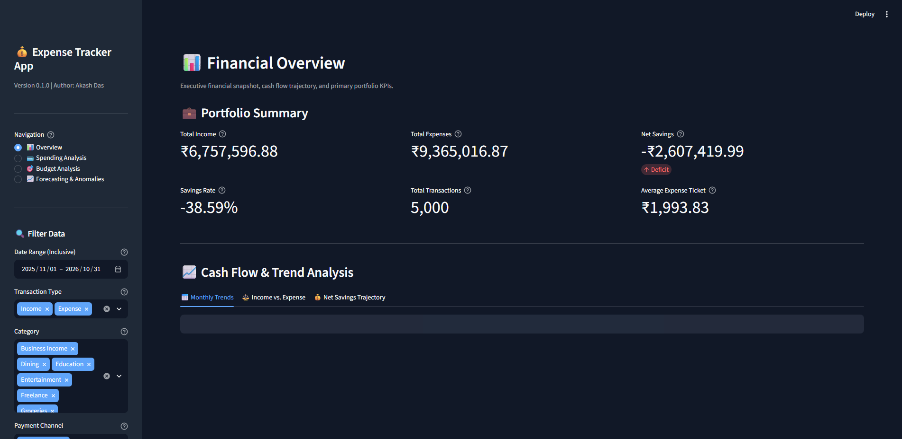
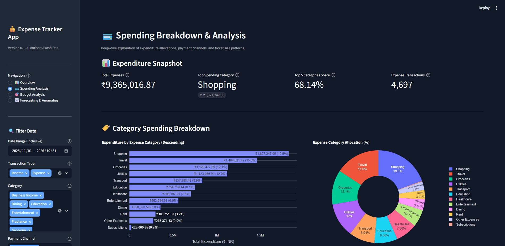
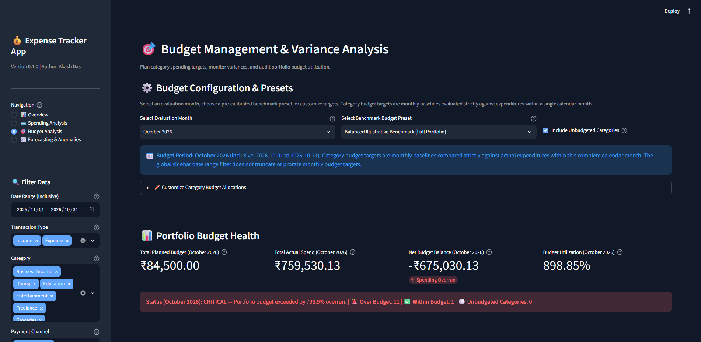
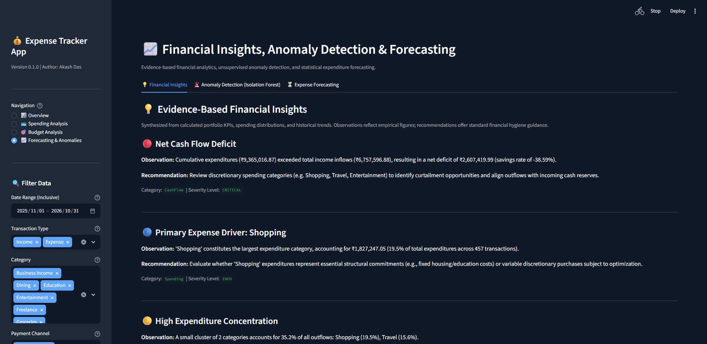
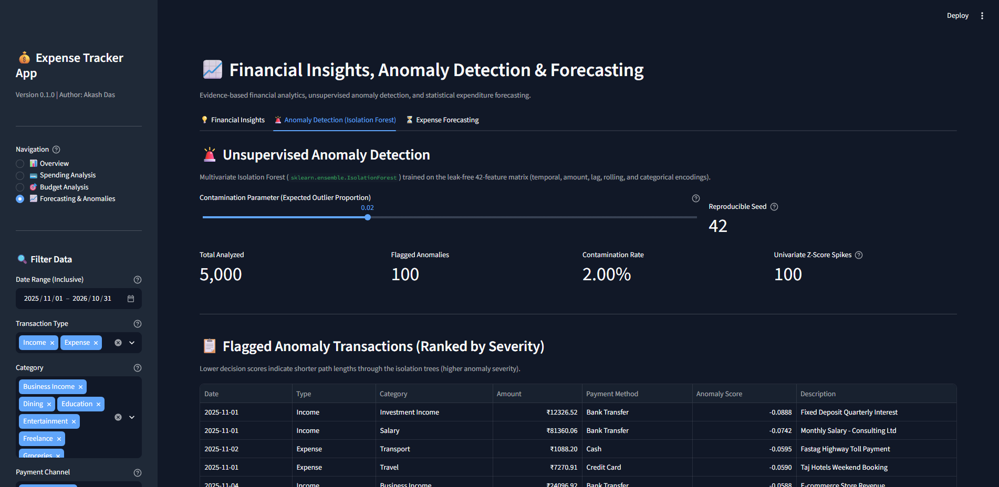
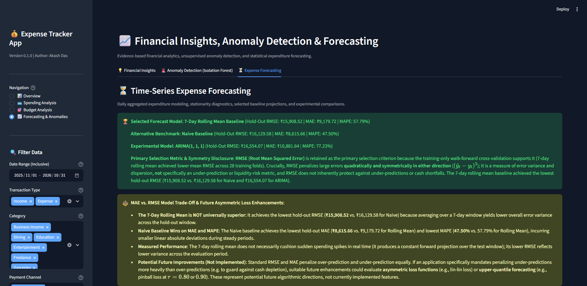

# Expense Tracker App using Data Science

[](https://www.python.org/downloads/)
[](docs/TESTING.md)
[](docs/ARCHITECTURE.md)
[](https://streamlit.io/)
[](docs/ARCHITECTURE.md)
[](docs/METHODOLOGY.md)
[](docs/METHODOLOGY.md)
[](docs/METHODOLOGY.md)
[](docs/METHODOLOGY.md)
[](docs/USER_GUIDE.md)
[-grey.svg)](data/sample/transactions.csv)
[](LICENSE)

An end-to-end personal finance analytics and machine learning application developed in Python. The system processes multi-channel financial transactions, enforces schema validation, engineers leak-free features, manages category budgets across calendar months, screens for spending anomalies using statistical and unsupervised machine learning methods, and forecasts daily expenditure trajectories using rolling baselines and ARIMA models. Delivered through an interactive Streamlit web application.

---

## Table of Contents

1. [Project Overview](#1-project-overview)
2. [Business Problem](#2-business-problem)
3. [Project Objectives](#3-project-objectives)
4. [Key Features](#4-key-features)
5. [Technology Stack](#5-technology-stack)
6. [System Architecture](#6-system-architecture)
7. [Data Pipeline and Workflow](#7-data-pipeline-and-workflow)
8. [Project Directory Structure](#8-project-directory-structure)
9. [Dataset Description](#9-dataset-description)
10. [Synthetic Data Generation Methodology](#10-synthetic-data-generation-methodology)
11. [Data Validation and Cleaning](#11-data-validation-and-cleaning)
12. [Exploratory Data Analysis](#12-exploratory-data-analysis)
13. [Feature Engineering](#13-feature-engineering)
14. [Financial Analysis and Key Performance Indicators](#14-financial-analysis-and-key-performance-indicators)
15. [Budget Management and Variance Analysis](#15-budget-management-and-variance-analysis)
16. [Financial Insights Engine](#16-financial-insights-engine)
17. [Anomaly Detection](#17-anomaly-detection)
18. [Expense Forecasting](#18-expense-forecasting)
19. [Interactive Streamlit Dashboard](#19-interactive-streamlit-dashboard)
20. [Dashboard Screenshots](#20-dashboard-screenshots)
21. [Installation Requirements](#21-installation-requirements)
22. [Environment Setup](#22-environment-setup)
23. [How to Run the Project](#23-how-to-run-the-project)
24. [How to Run Tests](#24-how-to-run-tests)
25. [Example Outputs and Results](#25-example-outputs-and-results)
26. [Model Evaluation and Validation](#26-model-evaluation-and-validation)
27. [Limitations](#27-limitations)
28. [Future Improvements](#28-future-improvements)
29. [Project Documentation References](#29-project-documentation-references)
30. [Author Information](#30-author-information)
31. [License](#31-license)

---

## 1. Project Overview

Personal financial management requires disciplined tracking of cash inflows, discretionary expenditures, recurring commitments, and payment instrument allocations. Traditional spreadsheets and rudimentary expense loggers lack automated validation, multi-dimensional feature engineering, anomaly screening, and statistical forecasting.

The Expense Tracker App addresses these challenges through a modular, reproducible Python codebase. The application ingests transaction data, performs rigorous schema validation, stores validated records in an ACID-compliant SQLite relational database, derives time-based and rolling financial features without data leakage, calculates core liquidity metrics in Indian Rupees (INR / Rs.), audits monthly budget variances, generates evidence-based heuristic insights, flags unusual transactions, and projects forward expense trajectories.

The solution is accessible through a multi-page interactive dashboard built with Streamlit and Plotly, designed for personal financial auditing and technical portfolio evaluation.

---

## 2. Business Problem

Modern consumer finances involve multiple payment channels (UPI, credit cards, debit cards, bank transfers, cash) and diverse spending categories. Without systematic data analysis, consumers face several recurring problems:

- **Dimensional Inconsistency**: Comparing a single-month budget target against full-year aggregate spending creates artificial budget overruns exceeding 10,000 percent.
- **Unstructured Outlier Visibility**: Rare, high-value expenditures (medical emergencies, holiday travel) distort average spending perceptions and obscure day-to-day burn rates.
- **Cash Flow Blindspots**: Lack of forward visibility into daily expenditure trends increases the risk of liquidity shortfalls before monthly income credits.
- **Channel Concentration**: Excessive dependency on single payment channels (such as credit cards or high-frequency UPI) complicates spending discipline.
- **Manual Overhead**: Manual transaction categorizations in spreadsheets often introduce formatting errors, null values, and duplicate records.

---

## 3. Project Objectives

The project delivers a data science solution meeting the following core objectives:

1. **Robust Data Pipeline**: Ingest, clean, validate, and persist raw transaction records with zero tolerance for schema violations or negative amounts.
2. **Leak-Free Feature Engineering**: Generate calendar, lag, rolling window, and interaction features without target leakage or future-data lookahead.
3. **Rigorous Financial Analytics**: Provide cash flow KPIs, category-level spending breakdowns, and calendar-month budget tracking with strict zero-budget semantics.
4. **Unsupervised Anomaly Detection**: Implement statistical and tree-based outlier detection models while transparently disclosing precision-recall trade-offs and sample-size uncertainties.
5. **Time Series Forecasting**: Evaluate rolling baselines and ARIMA models on out-of-sample holdout test data using root mean squared error (RMSE) as the primary model-selection criterion.
6. **Production-Ready Dashboard**: Build an interactive web dashboard with dynamic filtering, Plotly visualizations, responsive layouts, and zero runtime crashes.
7. **Comprehensive Testing**: Achieve 100 percent pass rate across an automated Pytest test suite covering all modules, edge cases, and user workflows.

---

## 4. Key Features

| Capability | Module | Implementation Details |
|---|---|---|
| Ingestion & Cleaning | `src/expense_tracker/data/` | Purity-preserving cleaning pipeline, schema validation, transaction ID formatting, date parsing. |
| Relational Storage | `src/expense_tracker/database/` | SQLite database connection, table schemas, parameterized queries, transaction rollbacks. |
| Feature Engineering | `src/expense_tracker/features/` | 42 numeric modeling features, rolling 7-day and 30-day stats, lag amounts, calendar dummy variables. |
| Financial Analytics | `src/expense_tracker/analytics/` | Income, expense, net savings, savings rate, mean/median ticket size, and category distributions. |
| Budget Management | `dashboard/budgets.py` | Calendar Month Budgeting, explicit Rs. 0.00 zero-budget rules, unbudgeted category isolation, presets. |
| Financial Insights | `src/expense_tracker/analytics/insights.py` | Configurable heuristics for category concentration, channel dependency, MoM acceleration, and outlier spikes. |
| Anomaly Detection | `src/expense_tracker/models/anomaly_detection.py` | Isolation Forest with 2% contamination heuristic, Tukey IQR and Z-score baselines, holdout evaluation. |
| Expense Forecasting | `src/expense_tracker/models/forecasting.py` | 7-day rolling mean baseline, naive baseline, experimental ARIMA(1, 1, 1), 28-fold walk-forward CV. |
| Web Dashboard | `app.py`, `dashboard/` | 4 multi-page Streamlit views, Plotly charts, sidebar date/category/channel filters, container-safe layout. |
| Automated Testing | `tests/` | 193 unit and integration tests with Pytest covering loaders, analytics, models, and dashboard rendering. |

---

## 5. Technology Stack

| Layer | Technology | Version | Purpose |
|---|---|---|---|
| Programming Language | Python | 3.11+ | Core runtime and application logic |
| Data Processing | Pandas | >= 2.0.0 | Tabular data manipulation, time series indexing, groupings |
| Numerical Computing | NumPy | >= 1.24.0 | Numerical vectors, random distributions, statistical transformations |
| Relational Storage | SQLite | Built-in (`sqlite3`) | Embedded relational database with ACID transactions |
| Machine Learning | Scikit-Learn | >= 1.3.0 | Isolation Forest unsupervised outlier detection |
| Time Series Modeling | Statsmodels | >= 0.14.0 | Augmented Dickey-Fuller stationarity tests, ARIMA modeling |
| Static Visualization | Matplotlib, Seaborn | >= 3.7.0, >= 0.12.0 | Exploratory analysis visual figures, distribution histograms |
| Interactive Visualization | Plotly | >= 5.15.0 | Interactive web charts, bar graphs, donuts, time series ribbons |
| Dashboard Framework | Streamlit | >= 1.28.0 | Multi-page web dashboard application |
| Quality Assurance | Pytest | >= 7.4.0 | Automated unit and integration testing suite |
| Interactive Prototyping | Jupyter | >= 1.0.0 | Exploratory data analysis notebook execution |

---

## 6. System Architecture

The application adopts a decoupled six-layer software architecture:

```text
+-----------------------------------------------------------------------------------+
|                            STREAMLIT WEB DASHBOARD                                |
|  Overview Page   |   Spending Analysis   |   Budget Analysis   |   Forecasting    |
+-----------------------------------------------------------------------------------+
                                          |
                                          v
+-----------------------------------------------------------------------------------+
|                         ANALYTICS & MACHINE LEARNING                              |
|  Financial Metrics  |  Spending Breakdown  |  Budget Variance  |  Trend Analysis  |
|  Financial Insights |  Isolation Forest    |  ADF Diagnostics  |  ARIMA & Rolling |
+-----------------------------------------------------------------------------------+
                                          |
                                          v
+-----------------------------------------------------------------------------------+
|                             FEATURE ENGINEERING                                   |
|  Temporal Calendar  |  Lags & Differences  |  Rolling 7d / 30d |  One-Hot Dummies |
+-----------------------------------------------------------------------------------+
                                          |
                                          v
+-----------------------------------------------------------------------------------+
|                           RELATIONAL PERSISTENCE                                  |
|  SQLite Database (expenses.db) | Transactions Table | Parameterized CRUD Queries   |
+-----------------------------------------------------------------------------------+
                                          |
                                          v
+-----------------------------------------------------------------------------------+
|                         DATA CLEANING & VALIDATION                                |
|  Schema Enforcement | Type Coercion | Boundary Checks | Purity & Immutability     |
+-----------------------------------------------------------------------------------+
                                          |
                                          v
+-----------------------------------------------------------------------------------+
|                              RAW INGESTION SOURCE                                 |
|  Synthetic Data Generator | CSV File Loader | Seeded NumPy Distributions          |
+-----------------------------------------------------------------------------------+
```

---

## 7. Data Pipeline and Workflow

The data lifecycle proceeds through structured stages:

1. **Data Ingestion**: Raw transaction files are loaded from disk. The loader validates file existence and verifies that mandatory schema columns are present.
2. **Data Cleaning**: Numeric amounts are coerced to positive floats. Dates are normalized to standard ISO format (`YYYY-MM-DD`). Text strings are stripped of leading and trailing whitespace.
3. **Data Validation**: Records are assessed against strict validation criteria. Negative or zero amounts, invalid transaction types, unapproved categories, and missing timestamps are rejected.
4. **Relational Storage**: Validated transactions are inserted into SQLite via parameterized queries with automatic transaction rollback upon database failure.
5. **Feature Transformation**: Validated records are enriched with calendar attributes, prior transaction intervals, rolling statistics, and dummy indicators.
6. **Analytics Computation**: Financial aggregations, budget variance calculations, and category percentages are evaluated through pure analytical functions.
7. **Model Training & Inference**: Anomaly scores are computed via Isolation Forest, and expenditure forecasts are generated via rolling baselines and ARIMA.
8. **Dashboard Presentation**: Computed metrics and Plotly figures are rendered across the Streamlit web dashboard.

---

## 8. Project Directory Structure

```text
Expense-Tracker-App-Data-Science/
|-- .github/
|   `-- workflows/
|       `-- tests.yml                     # Continuous integration workflow (GitHub Actions)
|-- .streamlit/
|   `-- config.toml                       # Streamlit server and visual theme configuration
|-- .vscode/
|   `-- settings.json                     # Shared editor and pytest test runner configuration
|-- dashboard/
|   |-- __init__.py                       # Dashboard package initialization
|   |-- budgets.py                        # Budget analysis page and calendar month budgeting
|   |-- charts.py                         # Plotly visualization creation functions
|   |-- data_processing.py                # Dashboard data loading and pure multi-criteria filters
|   |-- forecasting.py                    # Predictive forecasting and anomaly detection page
|   |-- overview.py                       # High-level financial overview page
|   `-- spending.py                       # Detailed spending breakdown page
|-- data/
|   |-- interim/
|   |   `-- .gitkeep                      # Placeholder for intermediate transformation files
|   |-- processed/
|   |   |-- .gitkeep                      # Placeholder for cleaned datasets
|   |   `-- enriched_transactions.csv     # Phase 4 feature-engineered dataset
|   |-- raw/
|   |   `-- .gitkeep                      # Placeholder for unprocessed input files
|   `-- sample/
|       |-- .gitkeep                      # Placeholder for sample demonstration files
|       `-- transactions.csv              # Tracked synthetic dataset (5,000 transactions)
|-- docs/
|   |-- 06_execution_log.md               # Detailed phase execution and audit logs
|   |-- ARCHITECTURE.md                   # System architecture and data flow guide
|   |-- DATA_DICTIONARY.md                # Comprehensive data schema and definitions
|   |-- METHODOLOGY.md                    # Core mathematical and algorithmic methodology
|   |-- README.md                         # Documentation suite index and architectural principles
|   |-- SCREENSHOT_CHECKLIST.md           # Visual asset checklist for portfolio presentation
|   |-- TESTING.md                        # Test suite structure and verification metrics
|   `-- USER_GUIDE.md                     # Application navigation and user manual
|-- images/
|   `-- .gitkeep                          # Dedicated directory for dashboard screenshots
|-- models/
|   `-- .gitkeep                          # Placeholder for serialized machine learning models
|-- notebooks/
|   |-- .gitkeep                          # Placeholder for Jupyter analysis notebooks
|   `-- 01_exploratory_data_analysis.ipynb# Completed exploratory data analysis notebook
|-- outputs/
|   |-- exports/
|   |   `-- .gitkeep                      # Placeholder for CSV and Excel data exports
|   `-- figures/
|       `-- .gitkeep                      # Placeholder for generated chart image files
|-- reports/
|   `-- figures/
|       |-- .gitkeep                      # Placeholder for analytical report figures
|       |-- expense_amount_distribution.png
|       |-- expense_category_distribution.png
|       |-- monthly_income_expense.png
|       |-- payment_method_distribution.png
|       `-- transaction_type_distribution.png
|-- src/
|   `-- expense_tracker/
|       |-- __init__.py                   # Package export root
|       |-- analytics/
|       |   |-- __init__.py               # Analytics subpackage exports
|       |   |-- budget_analysis.py        # Budget variance, utilization, and summary
|       |   |-- financial_metrics.py      # Core income, expense, and savings calculations
|       |   |-- insights.py               # Empirical financial insights generator
|       |   |-- spending_analysis.py      # Category and payment channel aggregations
|       |   `-- trend_analysis.py         # Chronological monthly trends and MoM growth
|       |-- config/
|       |   |-- __init__.py               # Configuration subpackage exports
|       |   `-- settings.py               # Path definitions and environment settings
|       |-- data/
|       |   |-- __init__.py               # Data subpackage exports
|       |   |-- data_cleaning.py          # Data normalization and cleaning pipeline
|       |   |-- data_generator.py         # Synthetic transaction data generator
|       |   |-- data_loader.py            # File ingestion and SQLite persistence
|       |   `-- validation.py             # Schema rules and column validation
|       |-- database/
|       |   |-- __init__.py               # Database subpackage exports
|       |   |-- connection.py             # SQLite connection management
|       |   `-- operations.py             # CRUD operations and batch transaction commits
|       |-- features/
|       |   |-- __init__.py               # Features subpackage exports
|       |   `-- feature_engineering.py    # Temporal, lag, and rolling feature engineering
|       |-- models/
|       |   |-- __init__.py               # Models subpackage exports
|       |   |-- anomaly_detection.py      # Isolation Forest and statistical outlier models
|       |   `-- forecasting.py            # Time series expense forecasting and evaluation
|       `-- utils/
|           |-- __init__.py               # Utilities subpackage exports
|           `-- helpers.py                # Formatting helpers for currency and dates
|-- tests/
|   |-- __init__.py                       # Test package initialization
|   |-- conftest.py                       # Shared pytest fixtures and mock DataFrames
|   |-- test_anomaly_detection.py         # Isolation Forest and outlier detection tests
|   |-- test_budget_analysis.py           # Budget variance and zero-budget semantics tests
|   |-- test_dashboard.py                 # Dashboard data loading, filters, and rendering tests
|   |-- test_data_cleaning.py             # Normalization and cleaning pipeline tests
|   |-- test_data_generator.py            # Synthetic generation and reproducibility tests
|   |-- test_data_loader.py               # CSV ingestion and SQLite persistence tests
|   |-- test_database.py                  # Database CRUD and transaction rollback tests
|   |-- test_feature_engineering.py       # Feature matrix, lag, and leakage prevention tests
|   |-- test_financial_metrics.py         # Core financial KPI calculation tests
|   |-- test_forecasting.py               # Rolling mean, ARIMA, and holdout evaluation tests
|   |-- test_insights.py                  # Financial insights heuristic tests
|   |-- test_spending_analysis.py         # Category and payment method aggregation tests
|   |-- test_trend_analysis.py            # Monthly trends and MoM growth tests
|   `-- test_validation.py                # Schema validation and boundary check tests
|-- .env.example                          # Environment variable configuration template
|-- .gitignore                            # Comprehensive git exclusion rules
|-- app.py                                # Streamlit dashboard main entry point
|-- CONTRIBUTING.md                       # Contribution guidelines
|-- LICENSE                               # MIT License
|-- README.md                             # Project overview and documentation
`-- requirements.txt                      # Project dependencies
```

---

## 9. Dataset Description

The primary dataset is located at [`data/sample/transactions.csv`](data/sample/transactions.csv). It contains 5,000 synthetic transaction records spanning exactly one calendar year (from November 1, 2025 to October 31, 2026).

| Column Name | Data Type | Constraint | Description |
|---|---|---|---|
| `transaction_id` | String | Unique, `TXN-\d{5}` | Sequential primary key identifier |
| `date` | String | ISO `YYYY-MM-DD` | Date of financial transaction |
| `type` | String | `Income` or `Expense` | Cash flow direction classification |
| `category` | String | Valid Taxonomy String | Specific spending or income category |
| `amount` | Float | Positive Float (> 0) | Transaction value in Indian Rupees (INR / Rs.) |
| `payment_method` | String | Valid Channel String | Instrument used to execute payment |
| `description` | String | Non-empty String | Transaction merchant or source narrative |

### Approved Taxonomy

- **Income Categories (4)**: `Salary`, `Freelance`, `Investment Income`, `Business Income`.
- **Expense Categories (12)**: `Rent`, `Groceries`, `Dining`, `Shopping`, `Utilities`, `Transport`, `Entertainment`, `Healthcare`, `Education`, `Subscriptions`, `Travel`, `Other Expenses`.
- **Payment Methods (5)**: `UPI`, `Credit Card`, `Debit Card`, `Bank Transfer`, `Cash`.

---

## 10. Synthetic Data Generation Methodology

The dataset is generated via [`src/expense_tracker/data/data_generator.py`](src/expense_tracker/data/data_generator.py) using NumPy with a deterministic random seed (`seed=42`).

### Modeling Real-World Spending Mechanics

- **Income Schedule**: Salaries are credited deterministically on the 1st of each month via Bank Transfer. Secondary freelance and investment income occur randomly throughout the month.
- **Fixed Commitments**: Rent is debited on the 1st of each month within a realistic residential range (Rs. 20,000 to Rs. 30,000). Utilities occur in the first week.
- **Discretionary Spending**: Daily grocery, dining, and shopping expenditures are modeled using right-skewed log-normal distributions to reflect realistic consumer ticket sizes.
- **Synthetic Shock Injection**: Exactly 12 transactions (0.24% of the dataset) represent simulated high-magnitude expenditure shocks (e.g., luxury travel, emergency medical bills, electronics). These transactions contain the marker `[UNUSUAL]` in their raw descriptions to serve as ground-truth labels for anomaly detection benchmarking. The marker is quarantined during feature engineering and masked in user-facing dashboard views.

---

## 11. Data Validation and Cleaning

Data integrity is enforced through pure, non-destructive functions in [`src/expense_tracker/data/validation.py`](src/expense_tracker/data/validation.py) and [`src/expense_tracker/data/data_cleaning.py`](src/expense_tracker/data/data_cleaning.py).

### Validation Rules

- **Schema Conformance**: Input DataFrames must contain all 7 mandatory columns.
- **Non-Negative Amounts**: Zero, negative, infinite, or NaN values are rejected.
- **Date Validity**: Timestamps must be valid ISO calendar dates within the supported project range.
- **Taxonomy Adherence**: Transaction types, categories, and payment methods must match approved categories.
- **Immutability**: Input DataFrames are never modified in-place; all transformations return fresh copies.

---

## 12. Exploratory Data Analysis

The exploratory analysis is recorded in [`notebooks/01_exploratory_data_analysis.ipynb`](notebooks/01_exploratory_data_analysis.ipynb). Generated visual figures are stored in [`reports/figures/`](reports/figures/).

### Key Empirical Findings

1. **Volume vs. Value Asymmetry**:
   - Expenses represent 93.94% of total transaction count (4,697 transactions) and Rs. 9,365,016.87 in total expenditure.
   - Income represents 6.06% of total transaction count (303 transactions) and Rs. 6,757,596.88 in total income.
2. **Right-Skewed Expense Distribution**:
   - Expense amounts exhibit extreme positive skewness (skewness = 2.45).
   - Mean expense ticket size: Rs. 1,993.83.
   - Median expense ticket size: Rs. 1,021.31.
   - The large divergence between mean and median reflects infrequent, high-value shock purchases.
3. **Payment Channel Adoption**:
   - UPI captures the highest transaction count (approximately 42%), driven by frequent low-ticket grocery and dining transactions.
   - Credit Card captures the highest expenditure volume, driven by travel bookings and shopping.
   - Bank Transfer handles the largest ticket sizes (mean exceeding Rs. 22,000), dominated by monthly salary credits and rent payments.

---

## 13. Feature Engineering

Feature engineering is implemented in [`src/expense_tracker/features/feature_engineering.py`](src/expense_tracker/features/feature_engineering.py), producing a 42-feature numeric matrix (`get_model_feature_matrix`).

### Engineered Feature Categories

1. **Temporal Calendar Attributes**: `year`, `month`, `quarter`, `day_of_month`, `day_of_week`, `is_weekend`.
2. **Lag Features**: Days elapsed since prior transaction, amount of previous transaction, days elapsed since previous expense, and previous expense amount.
3. **Rolling Window Statistics**: 7-day and 30-day cumulative sums, rolling means, and rolling transaction counts for expense expenditures.
4. **Interaction & Transformation Features**: Log-transformed amount (`log_amount = log1p(amount)`), text description character length, and word count.
5. **Categorical Dummies**: One-hot encoded binary indicator columns for all 16 transaction categories and 5 payment methods.

### Leakage Quarantine Policy

- **No Future Lookahead**: All lag and rolling calculations sort strictly chronologically and reference only historical records ($t-1$).
- **Same-Day Boundary**: Same-day transactions cannot access future events within the same date.
- **Target Leakage Safeguard**: Primary keys (`transaction_id`), raw text descriptions (`description`), text length proxies, and synthetic ground-truth markers (`[UNUSUAL]`) are quarantined and excluded from model feature matrices.

---

## 14. Financial Analysis and Key Performance Indicators

Financial analytics are implemented in pure functions under [`src/expense_tracker/analytics/`](src/expense_tracker/analytics/).

### Core Metric Formulations

- **Total Inflow**:
  $$\text{Total Income} = \sum_{i \in \text{Income}} \text{Amount}_i = \text{Rs. } 6,757,596.88$$
- **Total Outflow**:
  $$\text{Total Expenses} = \sum_{j \in \text{Expense}} \text{Amount}_j = \text{Rs. } 9,365,016.87$$
- **Net Capital Balance**:
  $$\text{Net Savings} = \text{Total Income} - \text{Total Expenses} = -\text{Rs. } 2,607,419.99$$
- **Savings Rate**:
  $$\text{Savings Rate} = \left(\frac{\text{Net Savings}}{\text{Total Income}}\right) \times 100.0 = -38.58\%$$
  *Zero-income policy: If total income is zero, the savings rate evaluates to 0.0% when expenses are zero, and NaN when expenses exist.*

---

## 15. Budget Management and Variance Analysis

The Budget Management engine is implemented in [`src/expense_tracker/analytics/budget_analysis.py`](src/expense_tracker/analytics/budget_analysis.py) and presented in [`dashboard/budgets.py`](dashboard/budgets.py).

### Calendar Month Budgeting (Option 1 Architecture)

Comparing single-month budget targets against full-year aggregate spending creates an artificial 11,000 percent utilization rate. The application implements **Calendar Month Budgeting**:

- **Dedicated Month Selector**: Users select a specific calendar month from the dataset. The selector identifies all 12 complete calendar months and defaults to the latest complete month: **October 2026**.
- **Complete Boundary Filtering**: Actual expenditures are bounded strictly from the 1st of the month to the final calendar day inclusive.
- **Global Sidebar Date Filter Isolation**: The sidebar date filter does not truncate or prorate monthly budget targets. The budget page receives the complete dataset and evaluates the full selected calendar month while honoring active category and payment channel filters.

### Budget Semantics

- **Explicit Rs. 0.00 Allocation**: A category assigned a budget of Rs. 0.00 with positive spending is strictly classified as **Over Budget**. If actual spending is zero, it is classified as **Within Budget** (0.0% utilization).
- **Unbudgeted Categories**: Categories absent from the budget definition receive `NaN` for planned amount, variance, and utilization, and a nullable Boolean `pd.NA` for `is_over_budget`. They are isolated from over-budget and under-budget counts.

### Verified Single-Month Figures

- **November 2025 Actuals**: Exactly 391 expense transactions totaling Rs. 826,899.27. Under the Balanced Benchmark preset (Rs. 84,500 budget), Rent is within budget (Rs. 24,647.87 actual vs Rs. 25,000.00 budget, 98.59% utilization).
- **October 2026 Actuals**: Exactly 380 expense transactions totaling Rs. 759,530.13. Under the Balanced Benchmark preset (Rs. 84,500 budget), Rent is within budget (Rs. 24,724.86 actual vs Rs. 25,000.00 budget, 98.90% utilization). Overall portfolio utilization is 898.85% (1 category within budget, 11 categories over budget due to synthetic high-value shopping and utility purchases).

---

## 16. Financial Insights Engine

The Financial Insights engine in [`src/expense_tracker/analytics/insights.py`](src/expense_tracker/analytics/insights.py) automatically synthesizes empirical portfolio observations into actionable financial hygiene guidance.

### Heuristic Screening Categories

1. **Cash Flow Solvency**: Evaluates overall capital surplus or deficit. Warns when net savings are negative or when income is absent.
2. **Category Concentration (Default: 15%)**: Flags expenditure categories capturing more than 15% of total outflow.
3. **Payment Channel Dependency (Default: 35%)**: Identifies payment channels capturing more than 35% of total volume (reflects consumer convenience, not credit risk).
4. **Month-over-Month Trajectory (Default: 20%)**: Identifies spending acceleration exceeding 20% compared to the previous month.
5. **Budget Variance**: Alerts when active categories exceed planned allocations.
6. **Outlier Purchase Spikes**: Flags extreme single transactions exceeding Tukey's upper fence ($Q_3 + 1.5 \times \text{IQR}$).

All generated insights are tiered by severity (`OPTIMAL`, `INFO`, `WARNING`, `CRITICAL`) and provide non-causal guidance.

---

## 17. Anomaly Detection

Implemented in [`src/expense_tracker/models/anomaly_detection.py`](src/expense_tracker/models/anomaly_detection.py).

### Modeling Strategy

- **Unsupervised Isolation Forest**: Trained strictly on the 42-feature numeric matrix (`get_model_feature_matrix`). Features are partitioned from target labels, raw descriptions, and ground-truth markers.
- **A Priori Contamination Heuristic**: The default contamination parameter is set to 0.02 (2.0% expected anomalies) based on domain heuristics, not tuned on evaluation labels.
- **Statistical Baselines**: Standard Z-score (3-sigma threshold) and Tukey's IQR rule are provided as comparative baselines.

### Evaluation Benchmarks & Disclosures

| Evaluation Setting | Positive Samples ($N_{\text{pos}}$) | Precision | Recall | F1 Score | Confusion Matrix |
|---|---|---|---|---|---|
| Full-Dataset Transductive Audit (5,000 txns) | 12 / 5,000 (0.24%) | 2.00% | 16.67% | 3.57% | TP=2, FP=98, TN=4890, FN=10 |
| Out-of-Sample Holdout (1,000 txns) | 1 / 1,000 (0.10%) | 3.23% | 100.00% | 6.25% | TP=1, FP=30, TN=969, FN=0 |

### Sample Size Disclosure

In the 20% holdout test set (1,000 transactions), there is only **1 positive ground-truth anomaly** ($N_{\text{pos}} = 1$). The 100% recall metric represents detecting a single sample. Missing that single record would reduce recall from 100% to 0%. This extreme sample-size uncertainty is explicitly documented. The model serves as an algorithmic demonstration on synthetic data and is not evidence of production fraud detection capability.

---

## 18. Expense Forecasting

Implemented in [`src/expense_tracker/models/forecasting.py`](src/expense_tracker/models/forecasting.py).

### Data Preparation & Stationarity

Transactions are aggregated into a daily continuous expenditure series (365 days, from November 1, 2025 to October 31, 2026). Zero-expense days are imputed with Rs. 0.00.

The Augmented Dickey-Fuller (ADF) test evaluates stationarity:
- Raw daily series test statistic: -4.37, p-value: 0.0001 (stationary at the 1% significance level).
- Differencing diagnostic: First differencing doubles series variance (variance ratio: 2.18x), indicating over-differencing. Consequently, ARIMA models requiring first differencing underperform stationary rolling baselines.

### Model Evaluation on Out-of-Sample Holdout (73 Days)

The dataset is partitioned chronologically into an 80% training set (292 days: 2025-11-01 to 2026-08-19) and a 20% holdout test set (73 days: 2026-08-20 to 2026-10-31).

| Model | Status | RMSE | MAE | MAPE | Model Role & Rationale |
|---|---|---|---|---|---|
| **7-Day Rolling Mean** | **Selected Model** | **Rs. 15,908.52** | Rs. 9,179.72 | 57.79% | Lowest RMSE; smooths high-frequency noise |
| **Naive Baseline (Last Value)** | Comparative Baseline | Rs. 16,129.58 | **Rs. 8,615.66** | **47.50%** | Lowest MAE; responsive to immediate level shifts |
| **ARIMA(1, 1, 1)** | Experimental Model | Rs. 16,554.07 | Rs. 10,881.64 | 77.23% | Over-differenced; higher error across all metrics |
| **Historical Mean** | Long-Term Baseline | Rs. 16,781.57 | Rs. 11,308.29 | 81.12% | Static baseline; ignores recent spending trends |

### Model Selection Transparency

- **Primary Selection Criterion**: Root Mean Squared Error (RMSE) is the primary model-selection criterion. Quadratic error penalties penalize large forecasting errors more heavily than linear penalties.
- **RMSE Error Symmetry**: RMSE penalizes positive errors (over-forecasting) and negative errors (under-forecasting) symmetrically ($(\hat{y}_t - y_t)^2$). It does not function as an asymmetric liquidity risk metric.
- **MAE vs. RMSE Trade-Off**: The 7-day rolling mean achieves the lowest RMSE, but the naive baseline achieves lower MAE and MAPE. The selected model is not universally superior across all metrics.
- **Pre-Test Training Walk-Forward Validation**: Model selection was established on training data alone prior to holdout evaluation using 28-fold walk-forward cross-validation (`min_train=90`, `horizon=7`, `step=7`). On training folds, the 7-day rolling mean achieved lower average RMSE (Rs. 19,963.35 vs. Rs. 23,165.07 for Naive).
- **Presentation Clipping**: Confidence interval lower bounds are clipped to Rs. 0.00 as a presentation boundary because expenditures cannot be negative.

---

## 19. Interactive Streamlit Dashboard

The Streamlit web application is structured into four primary views:

1. **Overview Page (`dashboard/overview.py`)**:
   - Executive financial KPI metric cards: Total Income, Total Expenses, Net Savings, Savings Rate.
   - Monthly cash flow trajectory grouped bar charts (Income vs. Expenses).
   - Monthly net savings bar chart with dynamic green surplus / red deficit indicators and a Rs. 0.00 baseline.
   - Recent transaction ledger with masked synthetic evaluation markers.
2. **Spending Analysis Page (`dashboard/spending.py`)**:
   - Expenditure snapshot metrics: Total Expenses, Top Spending Category, Top-5 Category Share, Expense Transaction Count.
   - Descending horizontal category expenditure bar chart and category allocation donut chart.
   - Payment method distribution chart and transaction volume tables.
   - Mean vs. median ticket size grouped bar chart highlighting category distribution skewness.
3. **Budget Analysis Page (`dashboard/budgets.py`)**:
   - Dedicated Calendar Month Selector with complete-month boundary validation.
   - Benchmark budget presets: Balanced Full Portfolio, Essential Core, Frugal Austere, and Zero-Discretionary Allocation.
   - Interactive category budget customizer (`st.data_editor`) with explicit `Is Budgeted` checkboxes.
   - Scoped portfolio health KPI cards: Planned Budget, Actual Spend, Net Balance, and Utilization %.
   - Grouped bar chart comparing budget allocations against actual expenditures with color-coded overrun indicators.
   - Detailed category variance ledger table with status badges (`Over Budget`, `Within Budget`, `Unbudgeted`).
4. **Forecasting & Anomalies Page (`dashboard/forecasting.py`)**:
   - **Tab 1: Financial Insights**: Evidence-based observations and actionable financial hygiene guidance across 6 screening heuristics.
   - **Tab 2: Anomaly Detection**: Contamination slider (0.5% to 5.0%), summary telemetry, severity-ranked anomaly table, and transductive/inductive benchmark confusion matrices with positive sample size disclosures.
   - **Tab 3: Expense Forecasting**: Data sufficiency diagnostics, ADF stationarity test results, holdout model comparison table, walk-forward validation fold statistics, and Plotly forward forecast charts with 95% confidence intervals.

---

## 20. Dashboard Screenshots

The dedicated `images/` directory holds visual assets for repository presentation.

| View | Target Image File | Status | Description |
|---|---|---|---|
| Overview Page | `images/dashboard_overview.png` | Placeholder Ready | Executive KPIs, monthly cash flow trajectory, and savings surplus/deficit charts. |
| Spending Analysis | `images/spending_analysis.png` | Placeholder Ready | Category expenditure breakdown, payment channels, and ticket size skewness. |
| Budget Analysis | `images/budget_analysis.png` | Placeholder Ready | Calendar Month Budgeting, benchmark presets, variance chart, and ledger table. |
| Financial Insights | `images/financial_insights.png` | Placeholder Ready | Heuristic insights cards with severity badges and hygiene guidance. |
| Anomaly Detection | `images/anomaly_detection.png` | Placeholder Ready | Isolation Forest controls, anomaly table, and benchmark confusion matrix. |
| Expense Forecasting | `images/expense_forecasting.png` | Placeholder Ready | Out-of-sample holdout metrics, ADF diagnostics, and forward projection ribbon. |

```markdown
<!-- Example Markdown Image Reference -->






```

*Screenshots can be placed directly into the `images/` folder to populate the visual preview in the GitHub repository.*

---

## 21. Installation Requirements

### System Prerequisites

- **Operating System**: Windows 10/11, macOS 12+, or modern Linux distribution (Ubuntu 22.04+ recommended).
- **Python Runtime**: Python 3.11 or later.
- **Git**: Git 2.30 or later.
- **Shell**: Windows PowerShell, Command Prompt, or Unix Bash/Zsh.

---

## 22. Environment Setup

Follow these step-by-step commands to set up the project on your local machine:

### 1. Clone the Repository

```bash
git clone https://github.com/your-username/expense-tracker-data-science.git
cd expense-tracker-data-science
```

### 2. Create a Virtual Environment

```powershell
# Windows PowerShell
python -m venv .venv
```

```bash
# macOS / Linux
python3 -m venv .venv
```

### 3. Activate the Virtual Environment

```powershell
# Windows PowerShell
.\.venv\Scripts\Activate.ps1
```

```bash
# macOS / Linux
source .venv/bin/activate
```

### 4. Upgrade Pip and Install Dependencies

```powershell
# Windows PowerShell
python -m pip install --upgrade pip
python -m pip install -r requirements.txt
```

```bash
# macOS / Linux
pip install --upgrade pip
pip install -r requirements.txt
```

### 5. Configure Environment Variables (Optional)

Copy `.env.example` to `.env` to configure custom environment settings:

```powershell
# Windows PowerShell
Copy-Item .env.example .env
```

```bash
# macOS / Linux
cp .env.example .env
```

---

## 23. How to Run the Project

### 1. Execute Ingestion Pipeline (CSV to SQLite)

To ingest the sample CSV, validate records, clean data, and populate the SQLite database:

```powershell
.\.venv\Scripts\python.exe -c "from expense_tracker.data.data_loader import ingest_transaction_file; stats = ingest_transaction_file('data/sample/transactions.csv'); print(stats)"
```

### 2. Launch the Streamlit Web Application

```powershell
# Windows PowerShell
.\.venv\Scripts\streamlit.exe run app.py
```

```bash
# macOS / Linux
streamlit run app.py
```

Once running, access the application in your browser at:
```text
http://localhost:8501
```

---

## 24. How to Run Tests

The test suite contains 193 automated unit and integration tests across 13 test files.

### Execute All Tests

```powershell
# Windows PowerShell
.\.venv\Scripts\pytest.exe -v
```

```bash
# macOS / Linux
pytest -v
```

### Execute Dashboard Regression Tests

```powershell
.\.venv\Scripts\pytest.exe tests/test_dashboard.py -v
```

### Execute Machine Learning Tests

```powershell
.\.venv\Scripts\pytest.exe tests/test_anomaly_detection.py tests/test_forecasting.py tests/test_insights.py -v
```

### Verify Python Syntax Compilation

```powershell
.\.venv\Scripts\python.exe -m compileall src dashboard tests app.py
```

---

## 25. Example Outputs and Results

### Single-Month Budget Variance (October 2026, Balanced Preset)

| Category | Monthly Budget (Rs.) | Actual Spend (Rs.) | Variance (Rs.) | Remaining (Rs.) | Utilization (%) | Status |
|---|---|---|---|---|---|---|
| Rent | 25,000.00 | 24,724.86 | -275.14 | 275.14 | 98.90% | Within Budget |
| Groceries | 12,000.00 | 81,252.76 | +69,252.76 | 0.00 | 677.11% | Over Budget |
| Dining | 6,000.00 | 29,421.38 | +23,421.38 | 0.00 | 490.36% | Over Budget |
| Shopping | 8,000.00 | 183,599.81 | +175,599.81 | 0.00 | 2,295.00% | Over Budget |
| Utilities | 5,000.00 | 97,494.26 | +92,494.26 | 0.00 | 1,949.89% | Over Budget |
| Transport | 4,000.00 | 71,190.19 | +67,190.19 | 0.00 | 1,779.75% | Over Budget |
| Entertainment | 4,000.00 | 60,935.72 | +56,935.72 | 0.00 | 1,523.39% | Over Budget |
| Healthcare | 3,000.00 | 52,817.03 | +49,817.03 | 0.00 | 1,760.57% | Over Budget |
| Education | 3,000.00 | 47,722.13 | +44,722.13 | 0.00 | 1,590.74% | Over Budget |
| Subscriptions | 1,500.00 | 1,718.00 | +218.00 | 0.00 | 114.53% | Over Budget |
| Travel | 10,000.00 | 102,488.55 | +92,488.55 | 0.00 | 1,024.89% | Over Budget |
| Other Expenses | 3,000.00 | 6,165.44 | +3,165.44 | 0.00 | 205.51% | Over Budget |
| **Total Portfolio** | **84,500.00** | **759,530.13** | **+675,030.13** | **-675,030.13** | **898.85%** | **1 Under / 11 Over** |

### Annual Portfolio Summary (5,000 Transactions)

- **Total Inflow**: Rs. 6,757,596.88 (303 transactions)
- **Total Outflow**: Rs. 9,365,016.87 (4,697 transactions)
- **Net Balance**: -Rs. 2,607,419.99
- **Savings Rate**: -38.58%
- **Mean Expense Ticket Size**: Rs. 1,993.83
- **Median Expense Ticket Size**: Rs. 1,021.31
- **Top Expense Category**: Shopping (Rs. 2,178,272.58 total, 23.26% share)

---

## 26. Model Evaluation and Validation

### Validation Standards

1. **Chronological Splitting**: All evaluation splits (anomaly holdout and forecasting holdout) split strictly chronologically (80% train / 20% test). Random train/test splits are prohibited on time series to prevent data leakage.
2. **Pre-Test Walk-Forward Validation**: Model selection between the 7-day rolling mean and naive baseline was validated using 28-fold walk-forward cross-validation strictly within the 292 training days. The rolling mean achieved lower average training RMSE (Rs. 19,963.35 vs Rs. 23,165.07).
3. **Safe Division Handling**: All percentage error calculations (MAPE, utilization, savings rates) protect against zero denominators by returning NaN or defined edge-case values.
4. **Deterministic Reproducibility**: All random operations (data generation, Isolation Forest) specify explicit random seeds (`random_state=42`).

---

## 27. Limitations

1. **Synthetic Data Nature**: The transaction records are synthetically generated using parameterized distributions. Results reflect simulation parameters and injected shock cases, not real household solvency or banking histories.
2. **Extreme Class Imbalance in Anomaly Detection**: With only 1 ground-truth positive anomaly in the holdout test set ($N_{\text{pos}} = 1$), recall exhibits extreme sample-size variance. The anomaly detection pipeline demonstrates feature processing and model execution, not validated real-world fraud detection.
3. **RMSE Error Symmetry**: RMSE penalizes over-forecasting and under-forecasting equally. It does not provide an asymmetric penalty for cash-flow liquidity shortfalls.
4. **Over-Differencing in ARIMA**: First differencing the stationary daily expenditure series doubles variance (2.18x), causing ARIMA(1, 1, 1) to underperform simple rolling averages.
5. **Static Parameter Assumptions**: Benchmark budget amounts and anomaly contamination rates are illustrative heuristics and require manual calibration for specific financial domains.

---

## 28. Future Improvements

1. **Asymmetric Loss Functions**: Implement lin-lin or upper-quantile pinball loss functions to specifically penalize under-forecasting in liquidity-critical scenarios.
2. **Automated Statement Ingestion**: Add optical character recognition (OCR) and PDF parsing pipelines for automated ingestion of Indian bank account statements.
3. **Multi-User Authentication**: Integrate user authentication and role-based access controls to support isolated multi-tenant portfolios.
4. **Automated Hyperparameter Tuning**: Implement Bayesian hyperparameter search for time-series model order selection across diverse spending categories.
5. **Automated Categorization Model**: Train an NLP text classification model on transaction narrative strings to automatically assign categories to raw merchant text.

---

## 29. Project Documentation References

Comprehensive technical documentation is maintained in the [`docs/`](docs/) directory:

| Document | Primary Focus |
|---|---|
| [`docs/ARCHITECTURE.md`](docs/ARCHITECTURE.md) | System architecture, decoupling principles, and design patterns |
| [`docs/DATA_DICTIONARY.md`](docs/DATA_DICTIONARY.md) | Schema definitions, constraints, and feature matrix metadata |
| [`docs/METHODOLOGY.md`](docs/METHODOLOGY.md) | Mathematical formulas, validation rules, and statistical derivations |
| [`docs/TESTING.md`](docs/TESTING.md) | Complete test suite structure, coverage matrix, and CI details |
| [`docs/USER_GUIDE.md`](docs/USER_GUIDE.md) | Navigation manual and page-by-page operational guide |
| [`docs/SCREENSHOT_CHECKLIST.md`](docs/SCREENSHOT_CHECKLIST.md) | Screenshot inventory and visual asset tracking checklist |
| [`docs/06_execution_log.md`](docs/06_execution_log.md) | Detailed chronological development and audit logs |

---

## 30. Author Information

- **Author**: Akash Das
- **Role**: Python Developer / Data Science Specialist
- **Project**: Expense Tracker App using Data Science
- **Domain**: Personal Finance Analytics, Machine Learning & Forecasting
- **GitHub**: [github.com/your-username](https://github.com/your-username)
- **LinkedIn**: [linkedin.com/in/your-profile](https://linkedin.com/in/your-profile)

---

## 31. License

This project is licensed under the terms of the **MIT License**. See the full text in the [`LICENSE`](LICENSE) file.

```text
Copyright (c) 2026 Akash Das

Permission is hereby granted, free of charge, to any person obtaining a copy
of this software and associated documentation files (the "Software"), to deal
in the Software without restriction, including without limitation the rights
to use, copy, modify, merge, publish, distribute, sublicense, and/or sell
copies of the Software, and to permit persons to whom the Software is
furnished to do so, subject to the following conditions:

The above copyright notice and this permission notice shall be included in all
copies or substantial portions of the Software.
```
