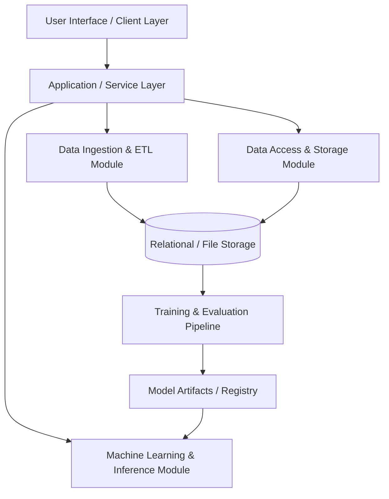

# 01. System Architecture

## 1. Overview
The **Expense Tracker App** is an intelligent data science-driven expense management platform. It combines transactional tracking, category classification, budget forecasting, and anomaly detection to provide automated personal finance insights.

---

## 2. High-Level Architecture

---

## 3. Core Architectural Layers

### 3.1. Presentation / User Interface Layer
- Provides an intuitive interface for entering expenses, viewing dashboards, categorizing spending, and monitoring budget forecasts.

### 3.2. Application & Business Logic Layer
- Manages routing, user requests, input validation, and orchestrates calls between data stores and analytical models.

### 3.3. Machine Learning & Analytics Engine
- **Transaction Categorization**: Automated categorization of merchant/description text using NLP/classification models.
- **Budget & Expense Forecasting**: Time-series models predicting future expenditures based on past habits.
- **Anomaly Detection**: Flagging irregular or unexpected spending spikes.

### 3.4. Data Storage & Persistence Layer
- Structured relational/document storage for transaction histories, category metadata, user budgets, and model checkpoint registry.

---

## 4. Technology Stack (To be updated as stack is confirmed)
- **Language**: Python
- **Data Processing**: Pandas, NumPy
- **Machine Learning**: Scikit-Learn, PyTorch / TensorFlow (as needed)
- **Database/Persistence**: SQLite / PostgreSQL
- **Testing**: Pytest

