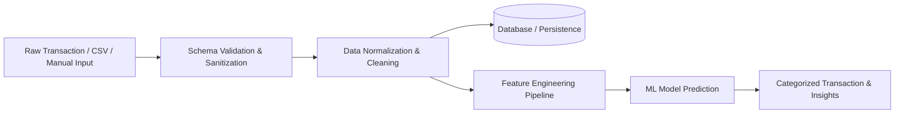

# 02. Data Flow & Pipelines

## 1. End-to-End Data Flow

The project processes data across three primary life cycles:
1. **Transaction Entry & Ingestion**
2. **Batch / Real-Time Machine Learning Inference**
3. **Data Aggregation & Analytical Reporting**

---

## 2. Ingestion & Preprocessing Pipeline

---

## 3. Data Pipeline Stages

### 3.1. Ingestion Stage
- **Sources**: Direct user entry, bulk CSV/statement upload, or API feeds.
- **Validation**: Verifies required fields (Date, Amount, Description/Merchant, Payment Method, Category).
- **Sanitization**: Strips invalid characters, converts datatypes, standardizes date formats (ISO 8601).

### 3.2. Transformation & Feature Engineering Stage
- **Text Processing**: Tokenization, lowercasing, stop-word removal, and vectorization (TF-IDF, Embeddings) on transaction descriptions.
- **Temporal Features**: Day of week, day of month, weekend flags, pay-cycle intervals.
- **Numerical Scaling**: Standardization / min-max scaling for monetary values.

### 3.3. Inference & Enrichment Stage
- Unclassified transactions are passed to the inference engine.
- Predicted category label and confidence score are appended.
- Flags for outliers/anomalies are calculated against historical rolling statistics.

### 3.4. Analytical Aggregation Stage
- Aggregates spending summaries by month, week, category, and budget thresholds for visualization and reporting.

