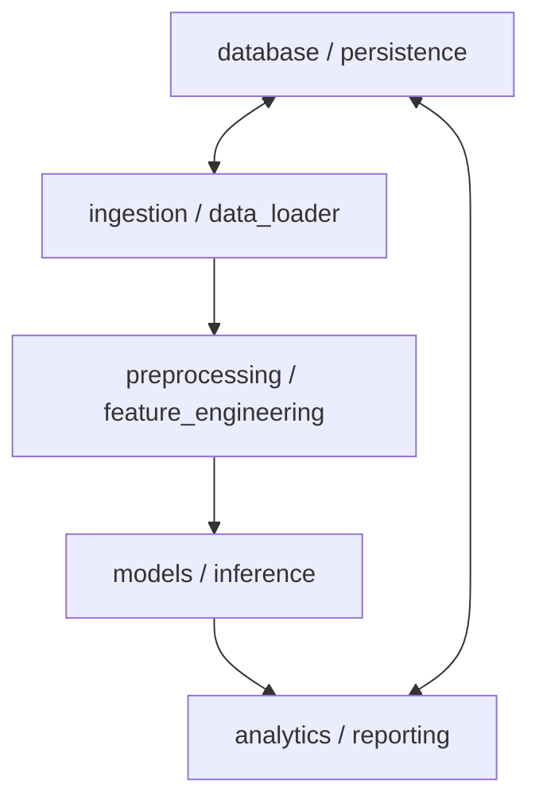

# 03. Modules Specification

## 1. Modular Design Overview

The application follows a modular, decoupled architecture to ensure testability, maintainability, and clean separation of concerns.

---

## 2. Module Breakdown

### 2.1. Module: Data Ingestion (`src/data/`)
- **Responsibilities**:
  - Load raw data from CSV, JSON, or database connections.
  - Parse inputs and handle schema validation.
  - Handle missing data and data integrity checks.
- **Key Functions / Interfaces**:
  - `load_data(source_path)`
  - `validate_schema(dataframe)`

### 2.2. Module: Preprocessing & Feature Engineering (`src/features/`)
- **Responsibilities**:
  - Clean and normalize text fields (descriptions/merchants).
  - Extract temporal and behavioral features.
  - Encode categorical variables and scale numerical attributes.
- **Key Functions / Interfaces**:
  - `clean_text(raw_text)`
  - `build_feature_pipeline()`

### 2.3. Module: Machine Learning Engine (`src/models/`)
- **Responsibilities**:
  - Model definitions (e.g., text classifiers, time-series predictors).
  - Model training, hyperparameter optimization, and evaluation loops.
  - Model persistence and inference interfaces.
- **Key Functions / Interfaces**:
  - `train_model(X_train, y_train)`
  - `predict_category(features)`
  - `evaluate_model(model, X_test, y_test)`

### 2.4. Module: Analytics & Budgeting (`src/analytics/`)
- **Responsibilities**:
  - Aggregate statistics (spending by category, monthly burn rate).
  - Compute budget utilization and anomaly alerts.
- **Key Functions / Interfaces**:
  - `calculate_monthly_summary(transactions)`
  - `detect_anomalies(transactions)`

### 2.5. Module: Persistence & Storage (`src/storage/` or `src/db/`)
- **Responsibilities**:
  - Manage database schema, connections, queries, and migrations.
- **Key Functions / Interfaces**:
  - `save_transaction(record)`
  - `fetch_transactions(filters)`

