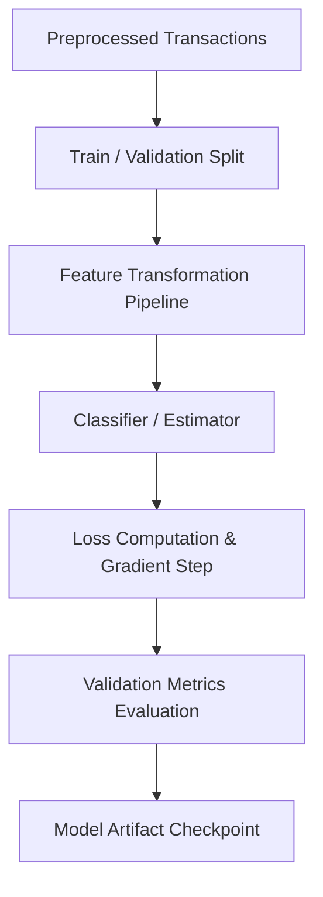

# 05. Model Architecture & Learning Mechanics

## 1. Machine Learning Objectives

1. **Transaction Classification**: Predict transaction category given unstructured text descriptions and metadata.
2. **Expense Forecasting / Trend Analysis**: Forecast future monthly/weekly expenditure.
3. **Anomaly / Outlier Detection**: Identify abnormal financial transactions.

---

## 2. Model Learning Mechanics

### 2.1. Feature Representation
- **Text Features**: N-gram TF-IDF vectorization or dense embedding representations.
- **Contextual Features**: Normalized amounts, day of week, day of month, transaction frequency.

### 2.2. Candidate Algorithms
- **Baseline**: Logistic Regression / Multinomial Naive Bayes (fast, interpretable).
- **Ensemble**: Random Forest / LightGBM / XGBoost.
- **Deep Learning / NLP**: Transformer-based text classification (e.g., DistilBERT) if dataset complexity justifies compute.

---

## 3. Training & Evaluation Protocol

### 3.1. Loss Function & Optimization
- **Multiclass Classification**: Cross-Entropy Loss (Log Loss).
- **Optimization Algorithm**: Adam / L-BFGS / SGD based on model selection.

### 3.2. Evaluation Metrics
- **Accuracy**: Overall classification rate.
- **Precision / Recall / Macro F1-Score**: Evaluated per category to prevent majority-class bias (e.g., groceries dominating small categories).
- **Confusion Matrix**: To inspect misclassification patterns between related categories.

