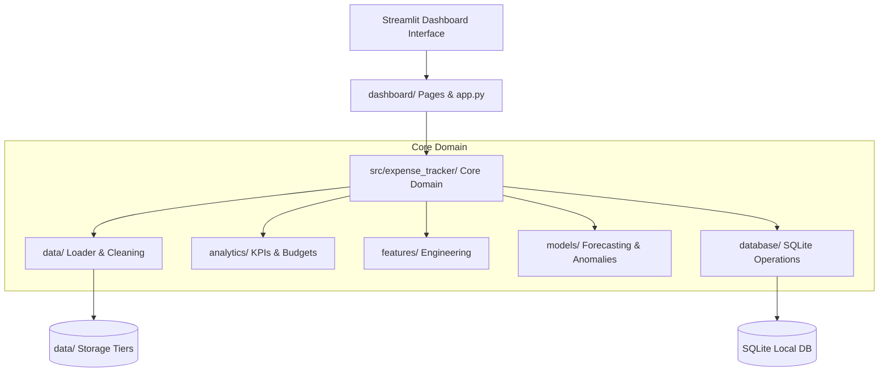

# System Architecture & Design

**Author: Akash Das**  
**Project**: Expense Tracker App using Data Science  

---

## 1. Architectural Philosophy
The application follows a modular, decoupled architecture where presentation, domain logic, data processing, machine learning models, and persistence are strictly segregated.

---

## 2. Component Decomposition

### 2.1. Presentation Layer (`app.py`, `dashboard/`)
- Streamlit multi-page interface providing interactive widgets and visualizations.
- Consumes domain functions from `expense_tracker` without directly executing low-level SQL or data transformations.

### 2.2. Core Library (`src/expense_tracker/`)
- **`config/settings.py`**: Project-relative path resolution, environment variables, and centralized settings.
- **`data/`**: Ingestion, validation, synthetic data generation, and cleaning routines.
- **`database/`**: SQLite connection pooling, table migration, and query execution.
- **`features/`**: Feature transformations, temporal extraction, and NLP description preprocessing.
- **`analytics/`**: Mathematical aggregations, KPI computations, and budget variance metrics.
- **`models/`**: Statistical forecasting (ARIMA) and anomaly detection engines (Isolation Forest).
- **`utils/`**: Helper utilities for formatting and date parsing.

### 2.3. Storage Tier (`data/`)
- **`raw/`**: Unmodified incoming transaction files.
- **`interim/`**: Partially cleaned intermediate data files.
- **`processed/`**: Curated, model-ready transaction datasets.
- **`sample/`**: Sanitized reference dataset committed to version control.

