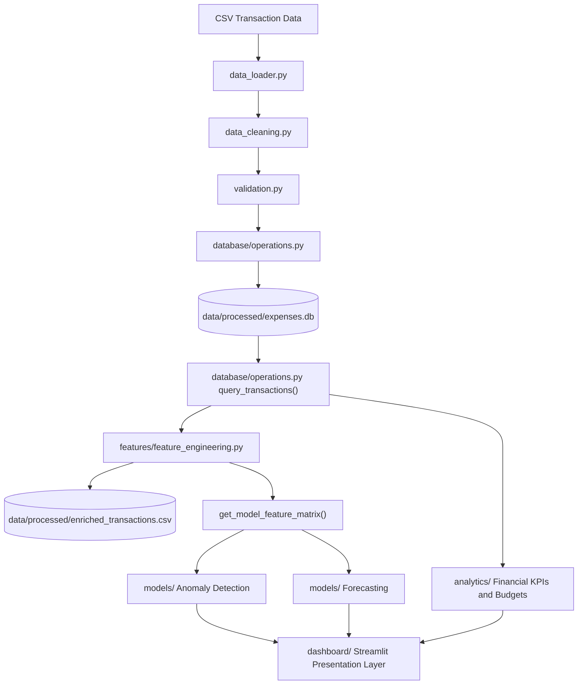
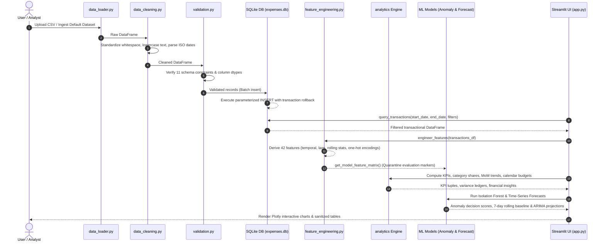

# System Architecture and Design

**Author:** Akash Das  
**Project:** Expense Tracker App using Data Science  
**Status:** Production-Ready (Phases 1-9 Completed)  

---

## 1. Architectural Philosophy and Patterns

The Expense Tracker App follows a decoupled, modular layered architecture where presentation, business logic, feature engineering, analytical calculations, machine learning inference, and data persistence are strictly segregated.

### Core Architectural Principles

1. **Strict Separation of Concerns**: Presentation (`app.py`, `dashboard/`) is completely decoupled from analytical computation (`src/expense_tracker/analytics/`) and machine learning algorithms (`src/expense_tracker/models/`). Neither Streamlit imports nor UI rendering primitives exist within the core business logic package.
2. **Defensive Data Ingestion**: All incoming records pass through a deterministic two-stage pipeline (cleaning followed by 11-rule schema constraint validation) before hitting the persistence tier.
3. **Single Source of Truth**: The SQLite database (`expenses.db`) serves as the ACID-compliant relational store. All analytical queries pass through `query_transactions()` with parameterization to prevent SQL injection.
4. **Zero Data Leakage Pipeline**: Feature engineering enforces strict backward-looking calculations (`closed='left'` on rolling windows) to prevent lookahead bias. Ground-truth evaluation markers (`[UNUSUAL]`) and length proxies are quarantined out of model matrices.
5. **Headless Testability**: Because business logic is written as pure, side-effect-free Python functions, the entire platform is testable via `pytest` without spinning up a live browser or server.

---

## 2. End-to-End Data Flow

The platform processes financial records across six sequential stages: Ingestion, Cleaning, Validation, Persistence, Transformation/Analytics, and Interactive Presentation.

---

## 3. Comprehensive Module Breakdown and Responsibilities

The codebase is organized into modular packages under `src/expense_tracker/` and `dashboard/`:

### 3.1. Data Ingestion and Validation Tier (`src/expense_tracker/data/`)

| File | Primary Responsibility | Key Functions / Classes | Inputs | Outputs |
|---|---|---|---|---|
| `data_loader.py` | Safe file ingestion, CSV reading, and pipeline orchestration | `load_csv()`, `ingest_transaction_file()` | File path / string | Raw / Validated DataFrame |
| `data_cleaning.py` | String normalization, whitespace stripping, and date parsing | `clean_transactions()`, `standardize_text()`, `parse_dates()` | Raw DataFrame | Cleaned DataFrame, Invalid row report |
| `validation.py` | Schema constraint enforcement and business rule verification | `validate_transactions()`, `ValidationResult` | Cleaned DataFrame | Validated DataFrame, error metadata |
| `data_generator.py` | Deterministic synthetic financial transaction generation | `generate_synthetic_transactions()` | Record count, seed, date range | Synthetic 5,000-record DataFrame |

### 3.2. Database Persistence Tier (`src/expense_tracker/database/`)

| File | Primary Responsibility | Key Functions / Classes | Inputs | Outputs |
|---|---|---|---|---|
| `connection.py` | SQLite connection lifecycle and directory auto-creation | `get_db_connection()`, `DatabaseConnection` context manager | DB file path | `sqlite3.Connection` object |
| `operations.py` | Schema DDL execution, atomic batch insertion, and parameterized queries | `init_database()`, `insert_transactions()`, `query_transactions()`, `get_transaction_counts()` | Connection, DataFrames, filters | Transaction counts, filtered DataFrames |

### 3.3. Feature Engineering Tier (`src/expense_tracker/features/`)

| File | Primary Responsibility | Key Functions / Classes | Inputs | Outputs |
|---|---|---|---|---|
| `feature_engineering.py` | Derives 42 statistical, temporal, lag, rolling, and categorical features | `engineer_features()`, `get_model_feature_matrix()`, `get_feature_names()` | Transaction DataFrame | 42-feature enriched DataFrame, numeric matrix |

### 3.4. Financial Analytics Engine (`src/expense_tracker/analytics/`)

| File | Primary Responsibility | Key Functions / Classes | Inputs | Outputs |
|---|---|---|---|---|
| `financial_metrics.py` | Core financial KPIs in INR: income, expense, savings rate, burn rate | `calculate_total_income()`, `calculate_total_expenses()`, `calculate_net_savings()`, `calculate_savings_rate()` | Filtered DataFrame | Numeric KPI values |
| `spending_analysis.py` | Category aggregation, Pareto distributions, ticket sizes, payment channel breakdown | `get_category_spending()`, `get_top_spending_categories()`, `get_payment_method_distribution()` | Expense DataFrame | Grouped aggregation DataFrames |
| `budget_analysis.py` | Option 1 Calendar Month Budgeting, variance tracking, utilization, benchmark presets | `calculate_budget_variance()`, `get_budget_health_summary()`, `get_benchmark_presets()` | Actual DataFrame, Budget dict/df, month range | Variance ledger DataFrame, health summary dict |
| `trend_analysis.py` | Chronological monthly cash flows, continuous gap filling, MoM velocity | `get_monthly_trends()`, `calculate_mom_changes()`, `get_trend_summary()` | Transaction DataFrame | Chronological trend DataFrames |
| `insights.py` | Deterministic rule-based financial hygiene insight engine | `generate_financial_insights()`, `FinancialInsight` dataclass | Processed DataFrames | List of structured insight objects |

### 3.5. Machine Learning and Modeling Tier (`src/expense_tracker/models/`)

| File | Primary Responsibility | Key Functions / Classes | Inputs | Outputs |
|---|---|---|---|---|
| `anomaly_detection.py` | Unsupervised multi-dimensional anomaly detection and statistical baselines | `detect_anomalies_isolation_forest()`, `detect_anomalies_iqr()`, `detect_anomalies_zscore()`, `evaluate_anomaly_detection_out_of_sample()` | 42-feature matrix, contamination rate | Anomaly labels (-1/1), scores, evaluation metrics |
| `forecasting.py` | Continuous daily time-series resampling, ADF test, rolling mean baseline, ARIMA | `prepare_daily_expense_series()`, `check_stationarity_adf()`, `forecast_rolling_mean()`, `train_arima_model()`, `evaluate_forecast_models()` | Daily expense Series, forecast horizon | Forecast Series, 95% CI bounds, holdout metrics |

### 3.6. Presentation and Visualization Tier (`dashboard/` and `app.py`)

| File | Primary Responsibility | Key Functions / Classes | Inputs | Outputs |
|---|---|---|---|---|
| `app.py` | Main Streamlit orchestrator, global session state, sidebar filters, page routing | `main()`, `@st.cache_data load_and_prepare_data()` | User widget interactions | Rendered Streamlit multi-page app |
| `dashboard/data_processing.py` | Pure non-mutating filtering, date boundary validation, synthetic marker masking | `filter_transactions()`, `mask_synthetic_markers()`, `get_filter_options()` | Raw DataFrame, filter parameters | Clean filtered DataFrame, display-safe text |
| `dashboard/charts.py` | Plotly visualization components styled on `plotly_white` in INR | `create_cash_flow_chart()`, `create_category_bar_chart()`, `create_forecast_chart()`, etc. | Aggregated DataFrames | Plotly Figure objects |
| `dashboard/overview.py` | Financial Overview page: high-level KPI cards, trajectory bars, recent ledger | `render_overview_page()` | Filtered DataFrame | Streamlit overview UI |
| `dashboard/spending.py` | Spending Breakdown page: Pareto charts, category share, payment channel analysis | `render_spending_page()` | Filtered DataFrame | Streamlit spending UI |
| `dashboard/budgets.py` | Budget Analysis page: Calendar month selector, benchmark presets, interactive editor | `render_budgets_page()` | Filtered DataFrame, full_df | Streamlit budget UI |
| `dashboard/forecasting.py` | ML Workspace: Financial Insights tab, Anomaly Detection tab, Forecasting tab | `render_forecasting_page()` | Filtered DataFrame, full_df | Streamlit ML UI |

---

## 4. Key Architectural Decisions and Trade-offs

### 4.1. Why SQLite Over PostgreSQL or Cloud Databases?
- **Serverless and Self-Contained**: SQLite requires zero external services or daemon processes, simplifying local reproduction and automated grading.
- **ACID Compliance**: Supports full transactions with commit and rollback, ensuring database integrity during batch ingestion.
- **In-Memory Testing Support**: Pytest suites leverage SQLite `:memory:` mode to execute 193 isolated tests in under 12 seconds with zero on-disk cleanup overhead.
- **Single-User Scope**: For personal finance tracking (thousands of records per year), SQLite provides microsecond read latencies without network round-trips.

### 4.2. Option 1: Calendar Month Budgeting Architecture
- **The Problem**: Initial designs compared the sidebar global date filter (12 months of spending, totalling ₹9.36M) against monthly benchmark presets (₹84.5K), resulting in an artificial 11,082% budget utilization overflow.
- **The Solution**: We implemented a dedicated calendar-month selector on the Budget page. The actual spending is strictly filtered to the exact start and end dates of the selected month ($start \le date \le end$).
- **Handling Unbudgeted Categories**: Categories present in transaction actuals but omitted from budgets are assigned `pd.NA` utilization rather than throwing zero-division errors, and are highlighted in a separate alert tier.

### 4.3. Preventing Target and Proxy Leakage
- **Marker Invariance**: The synthetic evaluation dataset embedded an `[UNUSUAL]` token in descriptions for 12 extreme ground-truth transactions. To prevent the model from learning this artificial cheat:
  1. `transaction_id`, raw `description`, and ground-truth evaluation labels are excluded from `get_model_feature_matrix()`.
  2. Description length metrics (`desc_char_length`, `desc_word_count`) were identified as proxy leakage vectors (since the 9-character tag inflated word and character counts) and quarantined out of model matrices.
  3. Automated unit tests (`test_detect_anomalies_isolation_forest_marker_invariance`) prove that stripping or injecting `[UNUSUAL]` yields identical feature values and decision scores.
- **Temporal Isolation**: Feature engineering enforces `closed='left'` on all 7-day and 30-day rolling sums and means. Transaction $t$ on day $d$ only aggregates transactions occurring strictly before day $d$, preventing same-day lookahead leakage.
