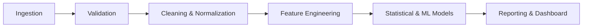

# Data Science & Analytical Methodology

**Author: Akash Das**  
**Project**: Expense Tracker App using Data Science  

---

## 1. Data Pipeline Lifecycle

### 1.1. Data Ingestion & Sanitization
1. **Format Handling**: Ingestion of CSV/Excel files and direct SQLite querying.
2. **Missing Value Resolution**: Imputation of default descriptions; strict rejection of rows missing critical attributes (`amount`, `date`).
3. **Type Normalization**: Coercion of date columns to standard datetime formats and conversion of currency strings into floating-point numbers.

---

## 2. Machine Learning Methodologies

### 2.1. Anomaly Detection
- **Statistical Filtering**:
  - Interquartile Range (IQR): Transactions exceeding $Q_3 + 1.5 \times IQR$ are flagged for review.
  - Z-Score Analysis: Flagging values where $|Z| > 3$.
- **Unsupervised ML (Isolation Forest)**:
  - Isolates abnormal transaction amounts based on feature combinations (Amount, Day of Week, Category frequency).

### 2.2. Time-Series Expense Forecasting
- **Data Resampling**: Aggregation of transactions into continuous daily/weekly intervals with zero-filling for missing dates.
- **Decomposition**: Analysis of trend, seasonality, and residual components.
- **Stationarity Check**: Augmented Dickey-Fuller (ADF) test prior to ARIMA parameter fitting.
- **Forecasting Models**:
  - ARIMA / SARIMAX models for seasonal trend forecasting.
  - Evaluation via Root Mean Squared Error (RMSE) and Mean Absolute Error (MAE).

