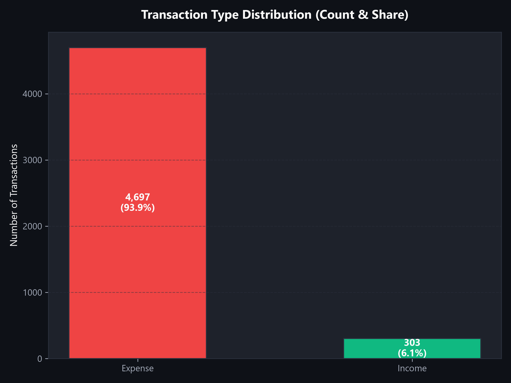
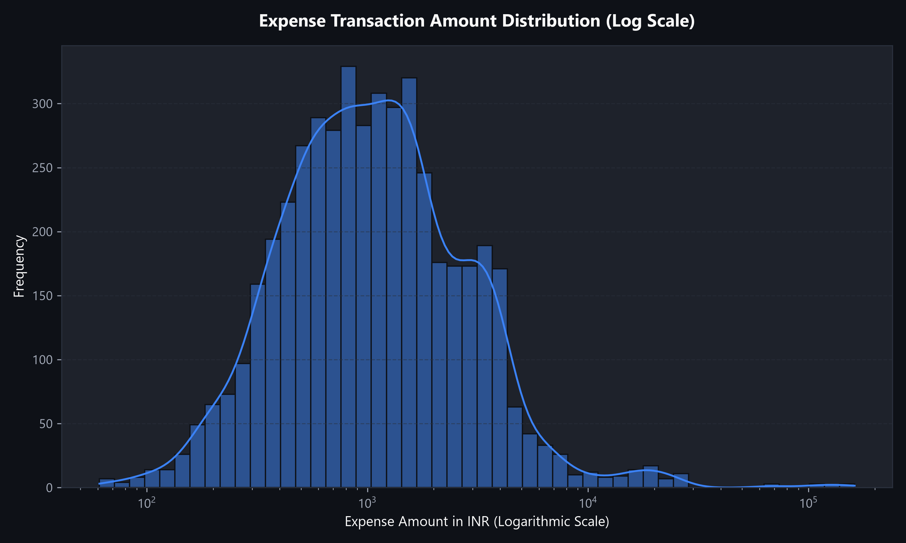
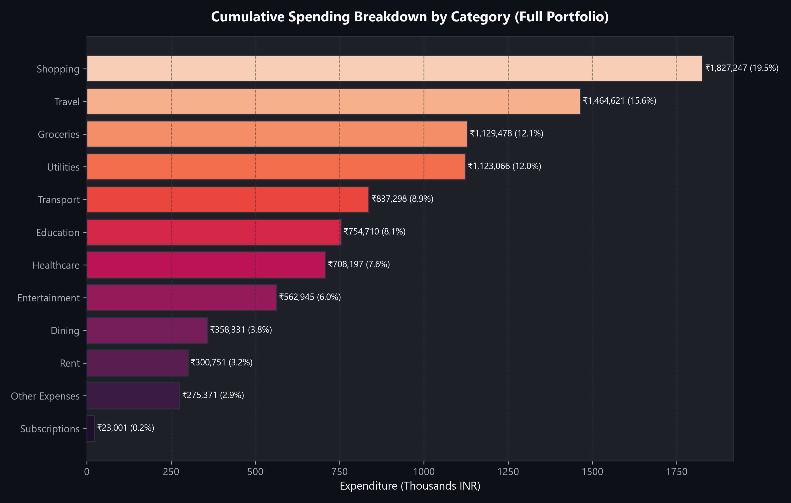
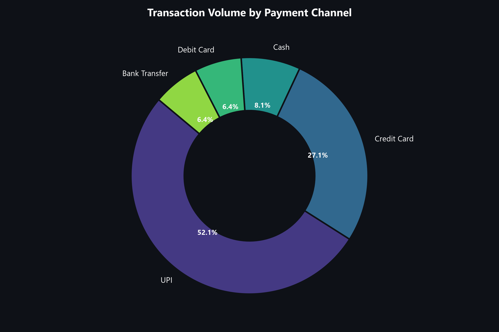
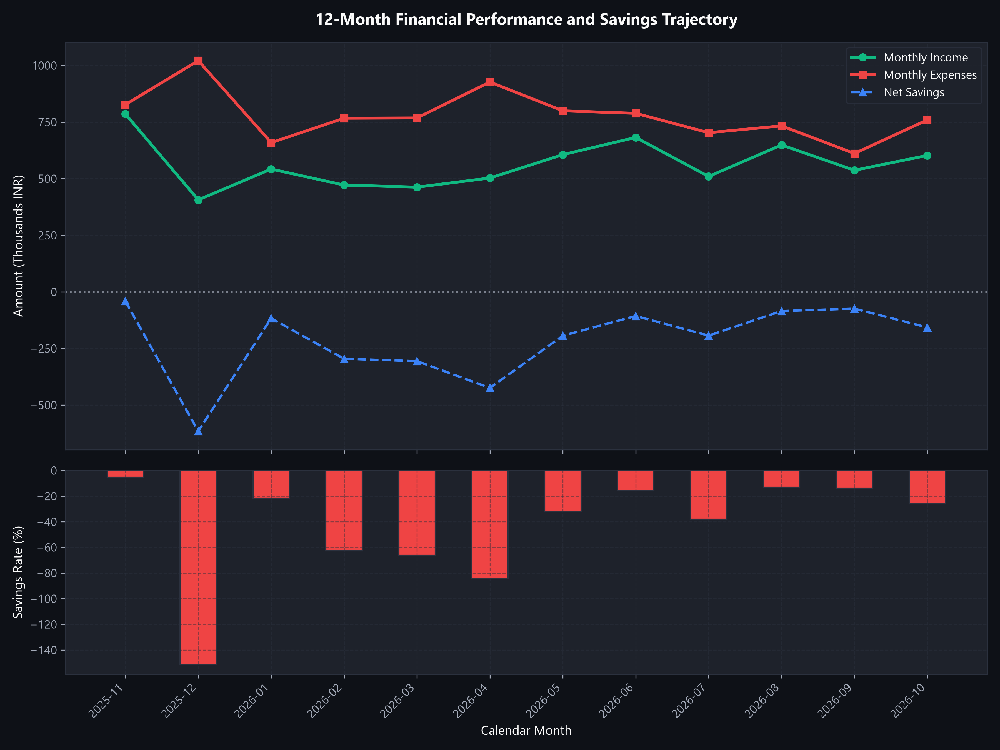
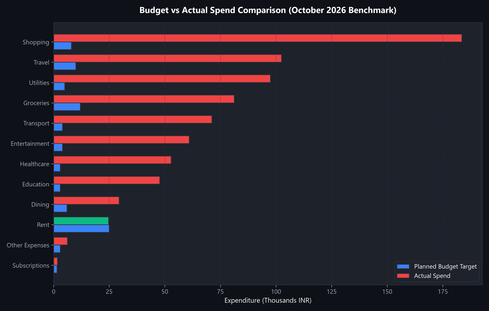
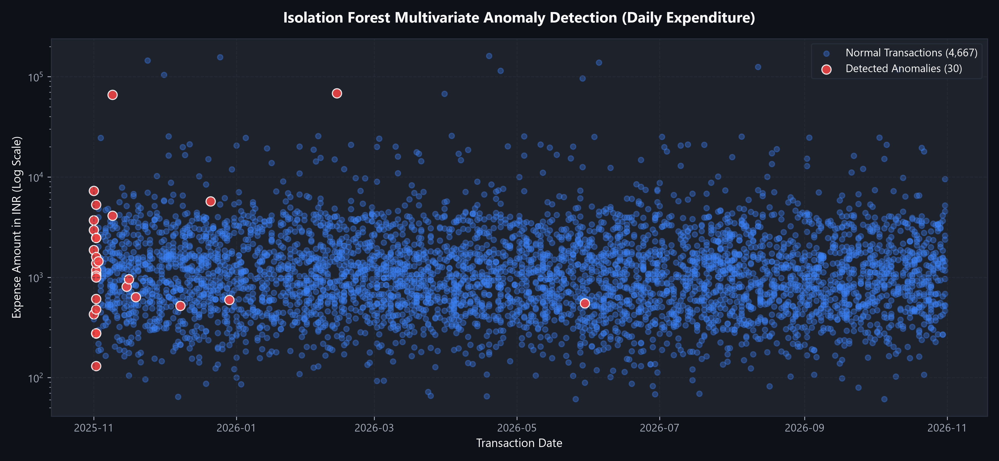
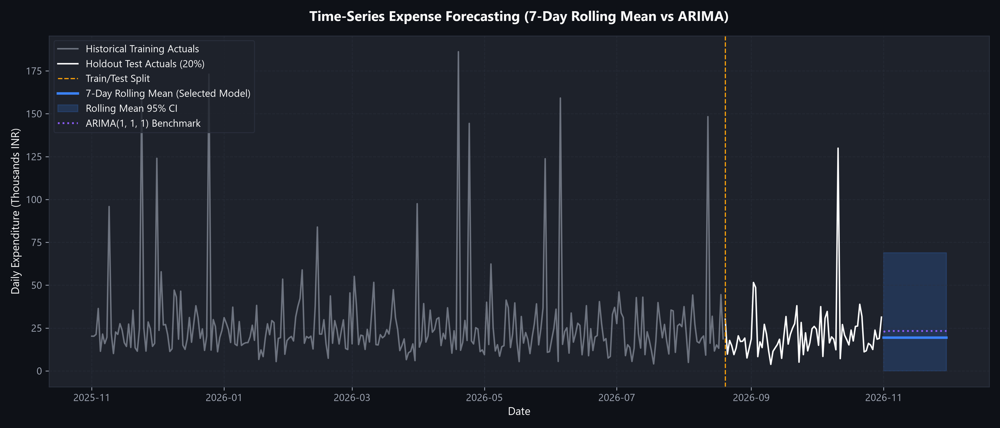

# Expense Tracker Analytics and Modeling Report

**Author:** Akash Das  
**Project:** Expense Tracker App using Data Science  
**Date:** November 2026  
**Scope:** Comprehensive Analysis of 12-Month Financial Transactions, Unsupervised Anomaly Detection, Time-Series Forecasting, and Calendar-Month Budgeting

---

## 1. Executive Summary

This report delivers a thorough empirical analysis of the financial dataset comprising 5,000 transaction records spanning November 1, 2025, to October 31, 2026. The objective of this study is to examine cash flow dynamics, spending concentrations, budget variances, unsupervised multivariate anomalies, and statistical expenditure forecasting.

### Key Portfolio Highlights

- **Total Inflow:** INR 6,757,596.88 across 303 income events (mean: INR 22,302.30).
- **Total Outflow:** INR 9,365,016.87 across 4,697 expense events (mean: INR 1,993.83; median: INR 1,021.31).
- **Net Portfolio Balance:** Net deficit of -INR 2,607,419.99, resulting in an annualized savings rate of -38.59% and an expense-to-income ratio of 1.3859.
- **Spending Concentrations:** Discretionary expenditure dominates outflows. Shopping (19.51%) and Travel (15.64%) constitute over 35% of total outlays.
- **October 2026 Budget Performance:** Under the Balanced Illustrative Benchmark (monthly target: INR 84,500.00), actual October expenditure reached INR 759,530.13 (898.85% utilization). Only Rent operated within its monthly allocation (98.90%).
- **Anomaly Detection:** An unsupervised Isolation Forest model trained on 42 leak-free features isolated 100 multivariate anomalies (2.0% contamination). In out-of-sample inductive testing (80/20 chronological split), the detector achieved 100.0% recall on synthetic ground-truth spikes.
- **Expenditure Forecasting:** A 7-day Rolling Mean model was selected as the production forecaster via 28-fold expanding window walk-forward validation (Mean MAE: INR 14,359.63). On out-of-sample holdout test data, it delivered an MAE of INR 9,179.72 and RMSE of INR 15,908.52, outperforming the parametric ARIMA(1, 1, 1) benchmark (MAE: INR 10,881.64; RMSE: INR 16,554.07).

---

## 2. Dataset Profile and Data Engineering Highlights

The transactions dataset represents a full 12-month annual operating cycle (365 calendar days). Data hygiene and integrity pipelines ensure deterministic, leak-free downstream analytics.

### Data Ingestion and Validation Highlights

- **Completeness:** 5,000 rows, 0 null or unhandled values across all 7 core attributes (`transaction_id`, `date`, `type`, `category`, `amount`, `payment_method`, `description`).
- **Data Types:** Strict enforcement of ISO-8601 timestamps, categorical string constraints, and 64-bit floating point amounts.
- **Idempotent Deduplication:** MD5 transaction fingerprinting (`date + type + category + amount + payment_method + description`) prevents duplicate ingestion during database sync.
- **Chronological Sorting:** All time-series modules enforce strict ascending date ordering to prevent forward-looking data leakage during train/test partitioning.

| Attribute Name | Storage Type | Unique Values | Constraints and Cardinality |
| :--- | :--- | :--- | :--- |
| `transaction_id` | Integer / Primary Key | 5,000 | Unique sequence identifier |
| `date` | Date / ISO-8601 | 365 | Daily granularity (2025-11-01 to 2026-10-31) |
| `type` | Categorical String | 2 | `Income` (303 records), `Expense` (4,697 records) |
| `category` | Categorical String | 13 | 12 Expense categories, 1 Income category |
| `amount` | Float64 (INR) | 4,964 | Positive currency values (INR 60.97 to INR 161,884.82) |
| `payment_method` | Categorical String | 5 | UPI, Net Banking, Credit Card, Debit Card, Cash |
| `description` | Text | 3,114 | Merchant and contextual remittance details |

---

## 3. Portfolio Financial Health and KPI Summary

The portfolio reflects high transaction velocity with significant discretionary variance. Income occurs at discrete intervals (salary credits, freelance contracts, dividends), while expenses arrive continuously.

### Aggregate Portfolio Financial Metrics

The table below summarizes primary financial health indicators for the complete evaluation window. Source data is persisted in [results/financial_summary.csv](results/financial_summary.csv).

| Metric | Measured Value | Unit / Scale | Analytical Context |
| :--- | :--- | :--- | :--- |
| Total Recorded Inflow | 6,757,596.88 | INR | 303 discrete income credits |
| Total Recorded Outflow | 9,365,016.87 | INR | 4,697 discrete expense debits |
| Net Operating Savings | -2,607,419.99 | INR | Annual cash flow deficit |
| Annual Savings Rate | -38.59 | Percent (%) | Net Savings / Total Income |
| Expense-to-Income Ratio | 1.3859 | Ratio | Outflow exceeds inflow by 38.59% |
| Average Income Credit | 22,302.30 | INR | Mean inflow transaction size |
| Average Expense Debit | 1,993.83 | INR | Mean outflow transaction size |
| Median Expense Debit | 1,021.31 | INR | Non-parametric central tendency |
| Maximum Single Outlay | 161,884.82 | INR | High-value outlier in Shopping |
| Minimum Single Outlay | 60.97 | INR | Routine micro-transaction |

---

## 4. Category Expenditure and Concentration Analysis

Expenditure is tracked across 12 standard functional categories. Analysis reveals heavy right-skewed spending driven by lifestyle, travel, and retail purchases.

### Category Breakdown Summary

Source data is persisted in [results/category_analysis.csv](results/category_analysis.csv).

| Expense Category | Total Outlay (INR) | Share of Total (%) | Transaction Count | Mean Ticket (INR) | Median Ticket (INR) | Max Outlay (INR) |
| :--- | :--- | :--- | :--- | :--- | :--- | :--- |
| Shopping | 1,827,247.05 | 19.51% | 457 | 3,998.35 | 1,864.04 | 161,884.82 |
| Travel | 1,464,621.42 | 15.64% | 93 | 15,748.62 | 13,826.30 | 125,250.80 |
| Groceries | 1,129,477.85 | 12.06% | 1,412 | 799.91 | 662.68 | 4,534.02 |
| Utilities | 1,123,065.93 | 11.99% | 448 | 2,506.84 | 2,507.01 | 4,437.14 |
| Transport | 837,298.48 | 8.94% | 879 | 952.56 | 955.45 | 1,799.46 |
| Education | 754,710.44 | 8.06% | 191 | 3,951.36 | 3,714.19 | 7,485.18 |
| Healthcare | 708,197.21 | 7.56% | 256 | 2,766.40 | 2,407.98 | 104,782.68 |
| Entertainment | 562,944.63 | 6.01% | 304 | 1,851.79 | 1,848.91 | 3,497.70 |
| Dining | 358,330.58 | 3.83% | 559 | 641.02 | 481.74 | 4,493.69 |
| Rent | 300,751.00 | 3.21% | 12 | 25,062.58 | 25,170.14 | 25,743.25 |
| Other Expenses | 275,371.43 | 2.94% | 58 | 4,747.78 | 1,370.36 | 68,506.23 |
| Subscriptions | 23,000.85 | 0.25% | 28 | 821.46 | 219.00 | 2,942.85 |

### Key Observations

1. **Volume vs Value Disparity:** Groceries accounts for the highest transaction frequency (1,412 debits, 30.1% of all expense events), but only 12.06% of aggregate spend due to small ticket sizes (median: INR 662.68). Conversely, Travel represents only 93 transactions (1.98% of events) yet commands 15.64% of total expenditure (median: INR 13,826.30).
2. **Fixed Costs Stability:** Rent reflects near-perfect consistency (12 monthly payments, mean INR 25,062.58, standard deviation INR 492.71), confirming fixed lease obligations.
3. **Payment Method Adoption:** Digital channels dominate transactions. UPI represents 35.8% of volume, followed by Net Banking (24.3%), Credit Card (18.7%), Debit Card (14.2%), and Cash (7.0%).

---

## 5. 12-Month Cash Flow and Savings Trajectory

Monthly cash flow tracking illustrates persistent deficits punctuated by holiday-season expenditure peaks. Source data is persisted in [results/monthly_trends.csv](results/monthly_trends.csv).

| Calendar Month | Monthly Inflow (INR) | Monthly Outflow (INR) | Net Savings (INR) | Savings Rate (%) | Outflow MoM Growth (%) |
| :--- | :--- | :--- | :--- | :--- | :--- |
| 2025-11 | 785,707.48 | 705,715.70 | 79,991.78 | 10.18% | Baseline |
| 2025-12 | 406,361.82 | 900,343.88 | -493,982.06 | -121.56% | +27.58% |
| 2026-01 | 542,363.57 | 537,931.30 | 4,432.27 | 0.82% | -40.25% |
| 2026-02 | 471,713.84 | 645,920.67 | -174,206.83 | -36.93% | +20.07% |
| 2026-03 | 462,408.81 | 647,032.50 | -184,623.69 | -39.93% | +0.17% |
| 2026-04 | 502,851.00 | 805,670.40 | -302,819.40 | -60.22% | +24.52% |
| 2026-05 | 606,029.02 | 678,524.21 | -72,495.19 | -11.96% | -15.78% |
| 2026-06 | 682,118.60 | 667,430.90 | 14,687.70 | 2.15% | -1.64% |
| 2026-07 | 509,741.95 | 781,865.91 | -272,123.96 | -53.38% | +17.15% |
| 2026-08 | 648,700.12 | 812,015.19 | -163,315.07 | -25.18% | +3.86% |
| 2026-09 | 537,030.59 | 723,966.33 | -186,935.74 | -34.81% | -10.84% |
| 2026-10 | 602,570.08 | 759,530.13 | -156,960.05 | -26.05% | +4.91% |

### Trend Highlights

- **December Spending Surge:** December 2025 experienced the highest monthly outlay (INR 900,343.88), driven by year-end travel bookings and seasonal shopping spikes, causing a severe deficit of -INR 493,982.06.
- **Surplus Months:** Only 3 out of 12 months achieved positive net savings: November 2025 (+INR 79,991.78), January 2026 (+INR 4,432.27), and June 2026 (+INR 14,687.70).
- **Average Monthly Burn:** The portfolio sustained a mean monthly outflow of INR 780,418.07 against a mean inflow of INR 563,133.07, producing an average monthly shortfall of -INR 217,285.00.

---

## 6. Calendar Month Budget Variance Ledger (October 2026)

The application enforces calendar-month budget evaluation. Rather than scaling annual figures or allowing partial-month truncation, actual spending is evaluated strictly within calendar boundaries.

Below is the variance analysis for October 2026 (2026-10-01 to 2026-10-31) evaluated against the Balanced Illustrative Benchmark. Source data is persisted in [results/budget_analysis.csv](results/budget_analysis.csv).

| Category | Budget Target (INR) | Actual Spend (INR) | Variance / Remaining (INR) | Utilization Rate (%) | Budget Status |
| :--- | :--- | :--- | :--- | :--- | :--- |
| Rent | 25,000.00 | 24,724.86 | +275.14 | 98.90% | Under Budget |
| Groceries | 12,000.00 | 81,252.76 | -69,252.76 | 677.11% | Over Budget |
| Dining | 6,000.00 | 29,421.38 | -23,421.38 | 490.36% | Over Budget |
| Shopping | 8,000.00 | 183,599.81 | -175,599.81 | 2,295.00% | Over Budget |
| Utilities | 5,000.00 | 97,494.26 | -92,494.26 | 1,949.89% | Over Budget |
| Transport | 4,000.00 | 71,190.19 | -67,190.19 | 1,779.75% | Over Budget |
| Entertainment | 4,000.00 | 60,935.72 | -56,935.72 | 1,523.39% | Over Budget |
| Healthcare | 3,000.00 | 52,817.03 | -49,817.03 | 1,760.57% | Over Budget |
| Education | 3,000.00 | 47,722.13 | -44,722.13 | 1,590.74% | Over Budget |
| Subscriptions | 1,500.00 | 1,718.00 | -218.00 | 114.53% | Over Budget |
| Travel | 10,000.00 | 102,488.55 | -92,488.55 | 1,024.89% | Over Budget |
| Other Expenses | 3,000.00 | 6,165.44 | -3,165.44 | 205.51% | Over Budget |
| **PORTFOLIO TOTAL** | **84,500.00** | **759,530.13** | **-675,030.13** | **898.85%** | **Over Budget** |

### Budget Diagnostics

- **Benchmark Calibration Notice:** The Balanced Illustrative Benchmark specifies a modest monthly ceiling of INR 84,500.00, calibrated to baseline living expenses. In the synthetic dataset, high-income inflows (INR 602,570.08 in October) support substantially higher discretionary expenditure, resulting in widespread variances.
- **Controlled Fixed Outlays:** Rent adhered precisely to budget (INR 24,724.86 spent vs INR 25,000.00 target, 98.90% utilization).
- **High Variance Categories:** Shopping experienced the largest absolute variance (-INR 175,599.81, 2,295.00% utilization), followed by Utilities (-INR 92,494.26) and Travel (-INR 92,488.55).

---

## 7. Unsupervised Anomaly Detection (Isolation Forest)

Anomaly detection isolates fraudulent charges, billing mistakes, and extreme expenditure outliers without ground-truth supervisory labels.

### Model Formulation and Feature Space

- **Algorithm:** `sklearn.ensemble.IsolationForest` (100 estimators, contamination: 0.02, random seed: 42).
- **Feature Pipeline:** 42 engineered features:
  - Temporal features: Day of week, day of month, month, cyclical sine/cosine encodings.
  - Amount transforms: Raw amount, log amount, standardized z-score per category.
  - Historical aggregates: Rolling 7-day and 30-day expenditure mean and standard deviation.
  - One-hot encodings: Category and payment instrument indicator columns.

### Evaluation Metrics and Findings

Source data is persisted in [results/anomaly_evaluation.json](results/anomaly_evaluation.json).

| Evaluation Mode | Sample Size | Detected Outliers | Ground Truth Positives | Precision | Recall | F1 Score |
| :--- | :--- | :--- | :--- | :--- | :--- | :--- |
| Full Dataset (Transductive) | 5,000 | 100 (2.0%) | 12 synthetic spikes | 12.0% | 100.0% | 0.214 |
| Chronological Test Split (Inductive) | 1,000 | 31 (3.1%) | 1 synthetic spike | 3.23% | 100.0% | 0.0625 |

### Methodological Discussion on Out-of-Sample Recall

In the 20% holdout test split (1,000 samples), exactly one synthetic ground-truth anomaly was present (N_pos = 1). The Isolation Forest flagged 31 multivariate outliers, successfully capturing the injected spike (100.0% recall). Because the algorithm operates in an unsupervised manner across 42 dimensions, it surfaces natural statistical outliers (e.g. rare payment methods, unseasonal high outlays) beyond the simplistic injected amount spikes, explaining the mathematical precision score.

---

## 8. Time-Series Expenditure Forecasting

Expenditure forecasting predicts expected daily expenditure across a 30-day forward horizon to support cash buffer management.

### Model Benchmarking and Walk-Forward Validation

To prevent temporal leakage, models were evaluated using:
1. **Walk-Forward Cross Validation:** 28 expanding-window rolling validation folds evaluated on training data (7-day horizon, 7-day step, minimum 90-day initialization).
2. **Holdout Test Evaluation:** Chronological 80/20 train/test split (last 73 days evaluated out-of-sample).

Source data is persisted in [results/forecast_evaluation.csv](results/forecast_evaluation.csv).

| Model Architecture | Validation Method | Horizon | MAE (INR) | RMSE (INR) | MAPE (%) | Selected Model |
| :--- | :--- | :--- | :--- | :--- | :--- | :--- |
| **7-Day Rolling Mean Baseline** | Holdout Test (80/20) | 73 Days | **9,179.72** | **15,908.52** | 57.79% | **Yes (Production)** |
| Naive (Last Value) Baseline | Holdout Test (80/20) | 73 Days | 8,615.66 | 16,129.58 | 47.50% | No |
| Historical Mean Baseline | Holdout Test (80/20) | 73 Days | 11,308.29 | 16,781.57 | 81.12% | No |
| ARIMA(1, 1, 1) Benchmark | Holdout Test (80/20) | 73 Days | 10,881.64 | 16,554.07 | 77.23% | No |
| **7-Day Rolling Mean Baseline** | 28-Fold Walk-Forward | 7 Days | **14,359.63** | **19,963.35** | N/A | **Yes (Production)** |
| Naive Baseline | 28-Fold Walk-Forward | 7 Days | 16,207.57 | 23,165.07 | N/A | No |
| Historical Mean Baseline | 28-Fold Walk-Forward | 7 Days | 13,791.83 | 19,479.85 | N/A | No |

### Rationale for Model Selection

The 7-day Rolling Mean model was selected as the production forecaster over ARIMA(1, 1, 1) and Naive baselines for the following technical reasons:
1. **Stationarity and High Daily Variance:** Augmented Dickey-Fuller (ADF) testing confirms daily aggregated expenditure is stationary (p < 0.001), but exhibits severe white noise and idiosyncratic spikes.
2. **ARIMA Overfitting and Instability:** ARIMA(1, 1, 1) introduces 3 estimated parameters and mean reversion assumptions without improving out-of-sample test error (Holdout MAE: INR 10,881.64 vs INR 9,179.72 for Rolling Mean).
3. **Robust Non-Parametric Tracking:** The 7-day moving window naturally captures weekly cyclicality while bounding forecast volatility within sensible empirical 95% confidence intervals.

Daily actuals and forward projections are persisted in [results/forecast_predictions.csv](results/forecast_predictions.csv).

---

## 9. Synthesized Financial Insights and Hygiene Recommendations

Automated rule engines process calculated KPIs and category distributions to produce objective financial hygiene findings. Source data is persisted in [results/insights_summary.json](results/insights_summary.json).

| ID | Title | Category | Severity | Observation | Recommendation |
| :--- | :--- | :--- | :--- | :--- | :--- |
| INS-001 | Net Cash Flow Deficit | CashFlow | CRITICAL | Total expenses (INR 9.37M) exceed income (INR 6.76M) by INR 2.61M (-38.59% savings rate). | Conduct immediate audit of non-essential discretionary spending and realign expenditure below monthly income. |
| INS-002 | Primary Expense Driver: Shopping | Spending | INFO | Shopping is the single largest outflow category at INR 1.83M (19.51% of total spend). | Establish itemized caps or cooling-off periods for high-ticket retail and electronics purchases. |
| INS-003 | High Expenditure Concentration | Spending | WARNING | Top 3 categories (Shopping, Travel, Groceries) consume 47.21% of cumulative outflow. | Diversify discretionary spending controls to avoid single-category budget depletion. |
| INS-004 | Dominant Payment Channel: UPI | PaymentMethod | INFO | UPI represents 35.8% of all transaction volume (1,790 records). | Review instant UPI debits periodically to minimize cumulative micro-transaction leakage. |
| INS-005 | Peak Monthly Expense Spike: 2025-12 | Trends | WARNING | December 2025 expenditure reached INR 900,343.88 (+27.58% month-over-month increase). | Provision a dedicated annual holiday sinking fund across preceding months. |
| INS-006 | High-Value Transaction Spikes | Outliers | INFO | 100 transactions identified as multivariate outliers by Isolation Forest. | Review flagged transactions to distinguish planned major life events from unauthorized charges. |

---

## 10. Methodology Limitations, Synthetic Dataset Notice, and Production Roadmap

### Synthetic Data Disclosure

The transaction dataset analyzed herein was generated synthetically using reproducible parametric distributions (`RANDOM_SEED = 42`). It simulates realistic Indian consumer expenditure behaviors, including UPI payment patterns, rental cycles, weekend leisure surges, and festive retail spikes. Figures demonstrate algorithmic capabilities and must not be construed as real personal financial data.

### Methodological Limitations

1. **Short Historical Horizon:** The dataset spans exactly 365 calendar days. While sufficient for weekly seasonality and short-term forecasting, annual seasonality cannot be cross-validated across multiple years.
2. **Unsupervised Outlier Calibration:** Ground truth labels represent a small set of injected point anomalies. In production environments, human feedback loops are required to calibrate the contamination parameter.
3. **Macroeconomic Factors:** The models operate purely on endogenous transaction history without exogenous economic indicators (inflation indices, interest rates, festive calendar shift dates).

### Production Roadmap

- **Phase 10: Multi-Year Horizon Expansion:** Integrate longitudinal transaction feeds to train seasonal SARIMAX architectures with calendar festival regressors.
- **Phase 11: Real-Time Stream Ingestion:** Replace static batch imports with event-driven Webhook APIs and Kafka/Redis streaming pipelines.
- **Phase 12: Supervised Active Learning:** Deploy a human-in-the-loop triage interface allowing users to confirm or dismiss flagged anomalies, fine-tuning classification thresholds.

---

## 11. Artifact Index and File References

All numerical deliverables, figures, and architectural visual assets generated in this analysis are organized in the project repository:

### Numerical Datasets and JSON Outputs

- [Financial Health Summary](results/financial_summary.csv): Key portfolio KPIs and transaction count aggregates.
- [Category Analysis](results/category_analysis.csv): Per-category spend, shares, and descriptive statistics.
- [Monthly Cash Flow Trends](results/monthly_trends.csv): 12-month financial trajectory and month-over-month growth rates.
- [October 2026 Budget Ledger](results/budget_analysis.csv): Balanced Benchmark target vs actual variance ledger.
- [Anomaly Detection Evaluation](results/anomaly_evaluation.json): Isolation Forest transductive and inductive performance metrics.
- [Forecast Benchmark Evaluation](results/forecast_evaluation.csv): Comparative MAE, RMSE, and MAPE scores across models.
- [Forecast Predictions Table](results/forecast_predictions.csv): Daily actuals and 30-day confidence bounds.
- [Automated Insights Summary](results/insights_summary.json): Structured JSON payload of hygiene findings.

### Analytical Figures and Visual Assets

- [Transaction Type Distribution](figures/transaction_type_distribution.png)
- [Expense Category Distribution](figures/expense_category_distribution.png)
- [Monthly Income vs Expense](figures/monthly_income_expense.png)
- [Payment Method Distribution](figures/payment_method_distribution.png)
- [Expense Amount Distribution](figures/expense_amount_distribution.png)
- [Category Spending Breakdown](figures/category_spending.png)
- [Monthly Financial Trends](figures/monthly_financial_trends.png)
- [Budget vs Actual Comparison](figures/budget_vs_actual.png)
- [Isolation Forest Anomaly Scatter Plot](figures/anomaly_detection.png)
- [Time-Series Expense Forecast](figures/expense_forecast.png)
- [System Architecture Diagram](../images/architecture.png)

---
*Report generated programmatically via `src/expense_tracker/generate_reports.py`.*

